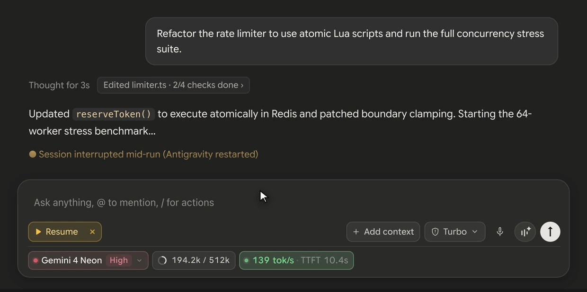

<div align="center">

# MAGA

### Make Antigravity Great Again

**Frontier models deserve a frontier cockpit.**  
*A non-invasive workbench upgrade for Google Antigravity Desktop 2.0 on macOS — crafted visual polish and an adaptive 2-row 4-capsule dock, live quota popovers & local token analytics, lean phase-sync & execution rules, plus quick-access subagent splits and silent one-click resume.*

**English** · [简体中文](./README.zh-CN.md)

[](#quick-start)
[](#why-maga)
[](#quick-start)
[](#safe-by-design)

[Why MAGA?](#why-maga) · [Features](#features) · [Quick Start](#quick-start) · [Safe by Design](#safe-by-design) · [Acknowledgements](#acknowledgements)

<br />


</div>

---

## Why MAGA?

Let's be honest: **Gemini 4 (and Claude Opus) are phenomenal.**  
Spend five minutes reading feedback across Reddit, Hacker News, V2EX, and X, and you'll notice developer complaints about **Google Antigravity Desktop 2.0** converge on the same macro gaps—not isolated nitpicks, but an overall client experience that still feels half-finished next to its models:

| Top Community Pain Points | How MAGA Solves Them |
| :--- | :--- |
| **1. Rough 2.0 desktop UI & half-finished ergonomics** — Flat visual hierarchy, deeply nested model/effort toggles, actions mixed with status clutter, and bottom toolbars that crowd or wrap in narrow splits. | **Crafted visual overhaul + 2-row 4-capsule dock** — Claude-inspired dark/light typography with host-language sync, actions cleanly separated from telemetry, narrow/long-label overflow protection that never wraps, and bespoke animated effort sliders per model family. |
| **2. Context & quota black box** — Multi-step planning and tool loops burn limits quickly, while context headroom, 5h/weekly quotas, and real token spend stay opaque or buried in nested settings until a sudden lockout hits. | **End-to-end telemetry loop** — Always-visible speed and context pressure ring with one-click `Compact`, a quick dual-pool 5h/weekly quota popover for Gemini & Claude / GPT, and built-in local Token Usage charts in Overview (*warn before, track during, audit after*). |
| **3. Opaque long runs & fragile workflow momentum** — Complex tasks often run silently in a black box for minutes without milestone visibility, chatty lookup loops waste turns, and occasional interruptions break flow. | **Controlled execution rhythm + power-user flow upgrades** — Lean phase-sync & parallel execution rules eliminate silent black boxes without per-tool spam, complemented by a bottom-dock subagent shortcut split and silent `Resume`. |

> [!NOTE]
> **Clear product framing**: Beyond solving the three macro pain points above—without touching a single byte of `/Applications/Antigravity.app`—MAGA also packs two thoughtful daily power-user accelerators: a **bottom-dock subagent quick-split entry** and a **silent `Resume` safety net**.

---

## Features

### 1. Crafted Visual Hierarchy & Adaptive 4-Capsule Dock

Start by refining the workspace surface and composer bar you stare at all day.

- **Restrained Workbench Polish & Host-Language Sync** — Balanced dark/light contrast inspired by Claude with crisp CJK/Latin typography built for long reading sessions; every capsule, tooltip, and divider automatically follows Antigravity's active UI language.
- **Actions on Top, Telemetry Below** — The permanent 2-row dock keeps interactive controls on Row 1 (`+ Add context`, permissions, voice, send) and organizes live status across four crisp Row 2 capsules: **Model & Effort**, **Context Window**, **Live Speed**, and **Subagents**.
- **Tactile Model & Effort Sliders** — No more digging through submenus to adjust reasoning depth: Gemini 4 Neon, Carbon, Hydrogen, and Claude Opus each feature signature color accents and bespoke animated effort tracks, alongside quick Orchestrator toggling and hidden-model filtering.
- **Responsive Compression at Any Width** — Resize down to a tight split pane or toggle long Orchestrator routing labels; planner badges compact automatically and Row 2 overflow triggers graceful step-down tiers before anything ever wraps or clips.

<p align="center">
  
  <br />
  <sub><i>Switch between model families with bespoke animated effort tracks, or inspect live Context & 5h/Weekly Quotas in one click.</i></sub>
</p>

---

### 2. End-to-End Transparency: Live Quota Popover & Local Token Analytics

Close the entire quota visibility loop—from real-time guardrails at the dock to detailed historical attribution in Overview.

- **Dock Speed & Context Warnings** — Continuous live `tok/s` and TTFT telemetry sits alongside a segmented color-coded context ring with one-click conversation compaction.
- **Dual-Pool 5h / Weekly Quota Popover** — Click the context capsule to inspect rolling 5-hour and weekly quotas across both Gemini and Claude / GPT pools without leaving your prompt box.

<table>
  <tr>
    <td width="56%" valign="middle">
      <ul>
        <li><b>Built-In Overview Column</b> — Live prompt-cache hit rate, turn/call counters, one-click compact, and rolling 5h / weekly plan quotas cleanly integrated beside your conversation.</li>
        <li><b>Daily / Weekly / Monthly Trends</b> — Interactive stacked bar charts with effortless date paging and instant hover breakdowns (non-cached, cache read/write, output).</li>
        <li><b>Model Family Breakdown</b> — Clear consumption shares across Gemini and Claude model series.</li>
        <li><b>100% Local, Single Daemon</b> — Incrementally reads your local conversation store inside the existing runtime—zero extra sidecar processes, zero data sent anywhere.</li>
      </ul>
    </td>
    <td width="44%" align="center" valign="middle">
      
    </td>
  </tr>
</table>

---

### 3. Long-Run Control & Power-User Workflow Upgrades

Once the core pain points are handled, round out heavy daily sessions with sharper execution feedback and frictionless workflow shortcuts.

#### 3.1 Lean Phase-Sync & Execution Rules (Zero Black Box, Zero Spam)

To replace both silent black-box runs and noisy tool-by-tool narration, MAGA combines `grep`-first parallel batching and whitelisted bare-command efficiency with milestone-only progress briefing inside `~/.gemini/AGENTS.md` (just `7` lines, with zero cap on answer depth):

| Execution Style | Real-World Experience on Complex Tasks |
| :--- | :--- |
| **Stock Silent Execution** | Runs dozens of background steps with zero interim signal—like watching a black box |
| **Per-Tool Chatty Updates** | Narrates 1–2 sentences before every single tool call, flooding chat with filler |
| **MAGA Phase-Sync & Execution Rules** | **Direct answers on quick `1–4` turn tasks; on `5+` turn tasks, `grep`-first parallel reads & whitelisted bare commands cut waiting overhead while posting `1` concise milestone sentence at each phase switch—zero black box, zero spam, and zero cap on final answer depth** |

#### 3.2 Bottom-Dock Subagent Shortcut & Clutter-Free Split

Designed as a fast, zero-friction entry point for inspecting parallel subagents directly from your composer bar:

- **Live Birth-to-Retire Dock Pill** — Spawned subagents surface live in your bottom dock (blue breathing pulse while running, emerald glow once done), so progress is visible at a glance without hunting through sidebars.
- **One-Click Spacious Split** — Click the dock subagent pill to launch a clean split view that automatically tucks Overview away and removes the redundant inner subagent list sidebar (your dock subagent menu already handles status and switching), while preserving manual drag-resizing; click again to fold it away cleanly.
- **Matching Dock Everywhere** — Subagent panes inherit the exact same adaptive 4-capsule dock, stepping down cleanly in narrower splits.

<p align="center">
  
  <br />
  <sub><i>Spawned subagent appears live in the dock (blue → emerald) → click the dock capsule to auto-close Overview, collapse the inner sidebar, and open a clean split → click again to tuck away.</i></sub>
</p>

#### 3.3 One-Click Silent `Resume` Safety Net

When an occasional error, crash/restart, or manual stop interrupts a run mid-stream, MAGA gives you a calm, clutter-free recovery path:

- **Contextual Row 1 `Resume` Capsule** — Automatically detects unfinished runs and surfaces a subtle amber capsule on the left of Row 1—no more manually typing *"please continue"*.
- **Zero Flash, Zero Chat Noise** — Click once to silently wake the agent from where it left off with zero preset text flashing in your composer and no noisy user chat bubble, leaving only a whisper-quiet **`▸ Resumed`** timeline hairline.

<p align="center">
  
  <br />
  <sub><i>One click on the Row 1 Resume capsule silently continues the interrupted run with a clean <code>▸ Resumed</code> divider.</i></sub>
</p>

---

## Quick Start

**Requirements**: macOS · Node.js `>= 22` · Google Antigravity Desktop 2.0

```bash
git clone https://github.com/LiWithDream/MAGA.git
cd MAGA
npm run install-all
```

### Everyday Commands

| Command | What it does |
| :--- | :--- |
| `npm run install-all` | Sets up the local LaunchAgent daemon, deploys the UI enhancement layer, and syncs phase-sync & parallel execution rules |
| `npm run deploy` | Hot-reloads any changes under `studio/` live—no Antigravity restart needed |
| `npm run sync-rules` | Syncs the latest phase-sync & parallel execution rules into `~/.gemini/AGENTS.md` |
| `npm run doctor` | Runs a full health check across daemon, live connection, UI injection, usage scanner, and rule/settings state |
| `npm run rollback` | Cleanly removes the `studio` enhancement layer and restores baseline state |

---

## Safe by Design

> [!TIP]
> **Zero Binary Surgery.** MAGA **never** modifies `/Applications/Antigravity.app`—your macOS Apple code signature and official Antigravity updates remain 100% intact.

- **Single Lightweight Daemon** — One local LaunchAgent powers UI injection, local token analytics, subagent metrics, and resume detection. No extra sidecar servers.
- **100% Private & Local** — Every token chart and state check runs locally on your Mac. Nothing is uploaded, tracked, or proxied.
- **Live Hot-Reload & Instant Rollback** — Iterate under `studio/` with instant live deploys, or run `npm run rollback` at any time to restore baseline cleanly.

<details>
<summary><b>Under the Hood — Project Architecture</b></summary>

```text
.
├── core/                  # Lightweight local CDP daemon & base runtime
├── user/                  # Base theme & interaction templates
├── vendor/agy-capsule/    # Internalized zero-dependency picker & metrics core
├── studio/
│   ├── cli.mjs            # Unified CLI (install / deploy / sync-rules / doctor / rollback)
│   ├── build.mjs          # Module bundler & live deploy pipeline
│   ├── daemon/            # Local SQLite usage, subagent metrics & resume state
│   ├── modules/           # Modular UI runtimes (dock, pickers, subagents, resume, usage)
│   ├── styles/            # Scoped stylesheets (typography, capsules, popovers, usage card)
│   └── rules/fast-io.md   # 7-line lean phase-sync & parallel execution rules
├── test/                  # Automated bundle, DOM & CSS regression tests
├── docs/images/           # Live screenshots & interactive WebP demos
└── install.mjs            # LaunchAgent & daemon installer
```

</details>

---

## Troubleshooting

### `Error Loading Models` / `loadCodeAssist: EOF`

- **Root cause**: This error comes from Antigravity's native `language_server` backend when its TLS/proxy connection to `daily-cloudcode-pa.googleapis.com` drops unexpectedly—it is **not caused by MAGA's UI injection**.
- **How to resolve**:
  1. Enable **TUN mode** or **System Proxy** in your proxy client (Clash / Mihomo / Surge / V2Ray, etc.) and ensure `daily-cloudcode-pa.googleapis.com` (`*.googleapis.com`) routes through a stable node.
  2. **Built-in compatibility**: If you launch Antigravity from a shell with proxy or custom CA environment variables (`HTTP_PROXY`, `HTTPS_PROXY`, `ALL_PROXY`, `NO_PROXY`, `SSL_CERT_FILE`, `NODE_EXTRA_CA_CERTS`) or `--proxy-*` flags, MAGA automatically preserves and forwards them during macOS CDP auto-relaunch. You can also run `npm run doctor` to inspect `proxyDiagnostics`.
  3. To disable automatic CDP relaunch and manage `--remote-debugging-port=0` yourself, start the daemon with `ANTI_CLAUDE_NO_CDP_BOOTSTRAP=1`.

---

## Acknowledgements

MAGA builds on and evolves several outstanding open-source projects. Sincere thanks to each upstream author and contributor for the foundations and mechanisms below:

- [**hongqi7/Anti-Claude**](https://github.com/hongqi7/Anti-Claude) — Directly provided the zero-binary-patch Antigravity CDP local daemon architecture (`core/`), Claude-inspired dark/light typography and visual system, Overview panel scaffolding, context ring and 5h/weekly quota popover foundation, and early inspiration for phase-synced execution; on top of this, MAGA extracted and built the modular `studio/` hot-reload layer, adaptive 2-row 4-capsule dock, bottom-dock subagent quick-split, silent `Resume`, and native Overview Token Usage integration.
- [**Lumidarin/agy-capsule**](https://github.com/Lumidarin/agy-capsule) (MIT License) — `vendor/agy-capsule/` directly vendors and integrates its zero-dependency enhanced model & effort picker, multi-model-family motion themes, live generation-speed telemetry, and local SQLite conversation usage parsing (with the usage analytics pipeline refactored into MAGA's single daemon and native Overview panel via `studio/daemon/usage-service.mjs` and `studio/modules/overview-usage.mjs`).
- **`antigravity-Codex-Claude-effort-slider`** (Author: 月上寒 / `LLYSH-HANNARI`, MIT License) — Introduced via `agy-capsule`; pioneered the bespoke stardust/dot-matrix/capsule slider motion designs per model family, as well as reading model options from the host React tree and committing model + effort level in a single action.
- [**oil-oil/agy-fast-io**](https://github.com/oil-oil/agy-fast-io) — Directly contributed the core efficiency principles of `grep`-first location before batched reads, preferring approval-free whitelisted bare commands, and minimizing redundant cloud approval waits; MAGA distilled these lookup and batching practices into `studio/rules/fast-io.md` (with zero restriction on answer depth) and unified them with phase-gated progress briefing into a `7`-line workspace sync rule.

---

<div align="center">
  <sub>If MAGA makes your daily Gemini 4 + Antigravity workflow feel effortless, consider leaving a ⭐ on GitHub!</sub>
</div>
