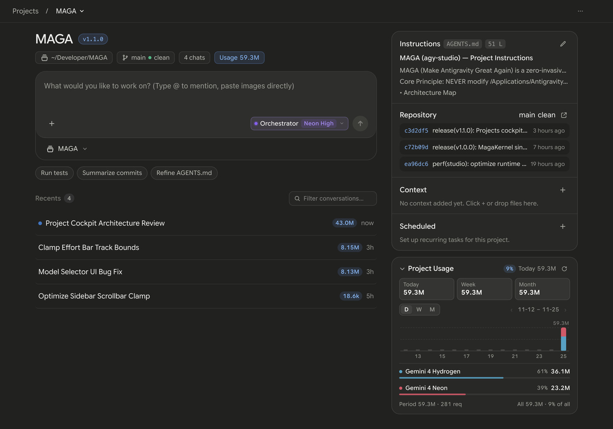
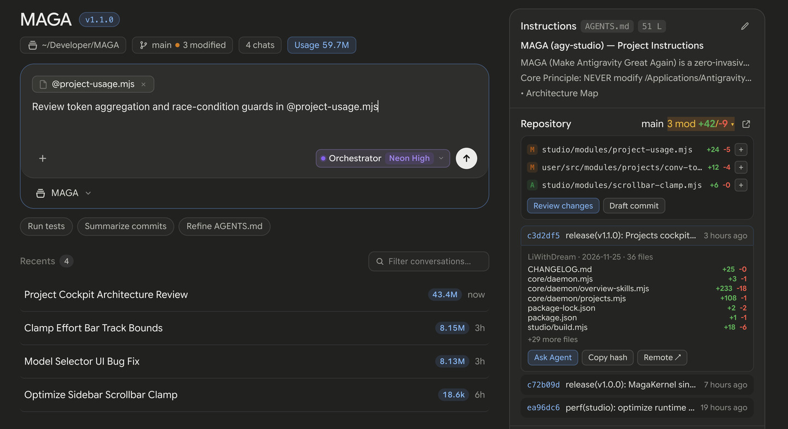
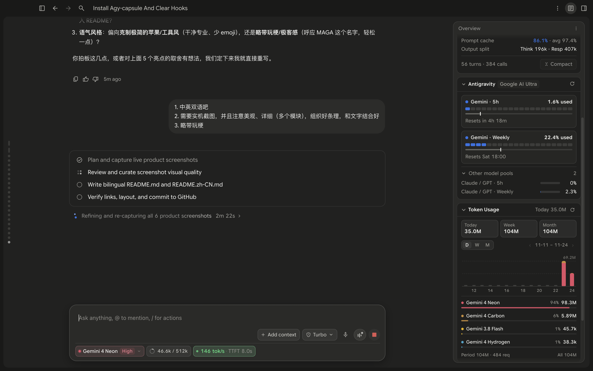
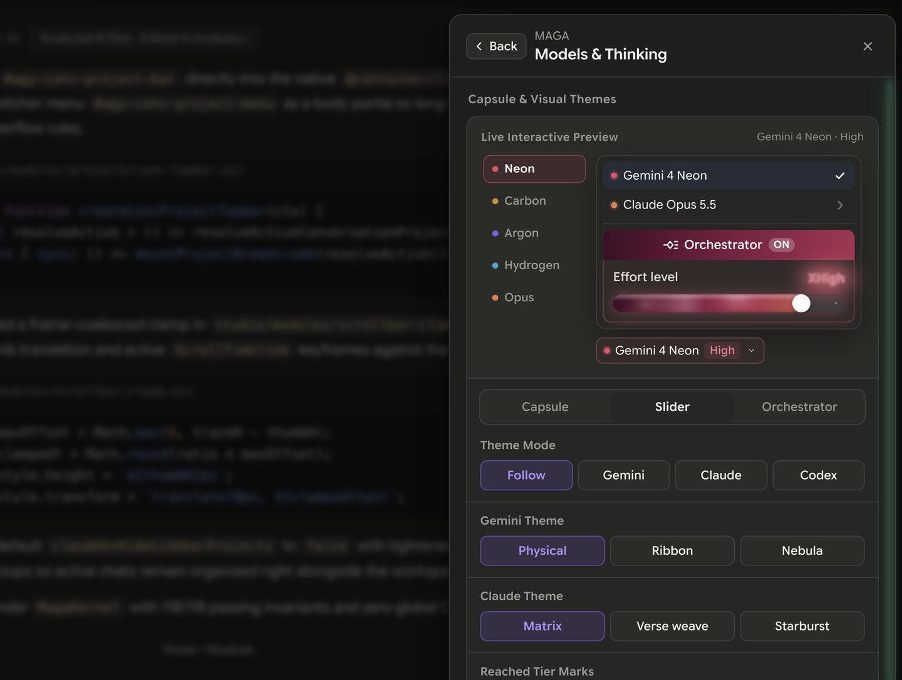
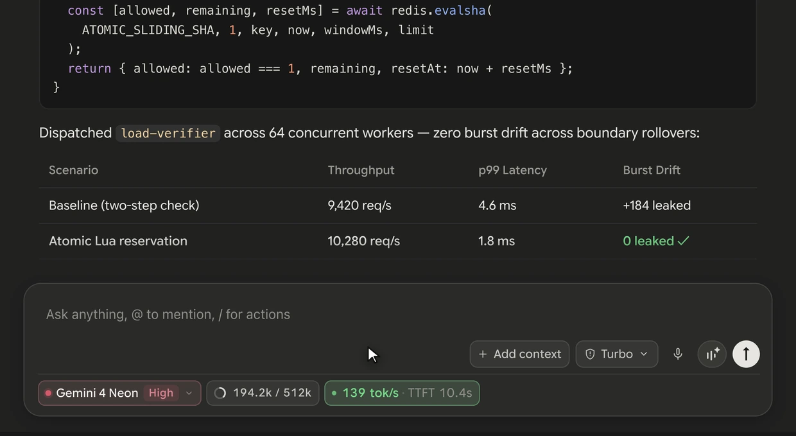

<div align="center">

# MAGA

**A multi-project & Git-worktree cockpit for Google Antigravity Desktop 2.0 on macOS.**  
Per-project token analytics, live Git drawers, dual-pool 5h/weekly quota tracking, quota-guarded Claude Opus Gate, and a single-observer UI runtime — without modifying `/Applications/Antigravity.app`.

**English** · [简体中文](./README.zh-CN.md)

[](#limitations--platform-support)
[](#what-it-adds)
[](#quick-start)
[](#architecture--safety)
[](./LICENSE)

[Quick Start](#quick-start) · [What It Adds](#what-it-adds) · [Compatibility](#compatibility) · [Settings Reference](#settings-reference) · [Troubleshooting](#troubleshooting) · [Acknowledgements](#acknowledgements)

<br />


<sub><i>Projects Cockpit sorting, live Git dirty/commit drawers with <code>@file</code> insertion, per-project Token Usage charts, and unified Settings Studio.</i></sub>

</div>

---

## Why I Built This

Running multiple repositories and parallel agent sessions in **Google Antigravity Desktop 2.0** exposes three daily friction points:

1. **Multi-project workflows lack a real cockpit**: Native Projects leave you guessing which repo has uncommitted changes, which branch or worktree an old chat ran in, and which project burned your weekly tokens.
2. **Quota and context limits sneak up on you**: Rolling 5-hour limits, weekly Gemini / Claude / GPT pool headroom, cache hit rates, and per-conversation spend stay hidden until you hit a lockout.
3. **Naive DOM mods lag the Electron window**: Injecting multiple `MutationObserver` loops or global CSS `:has()` selectors slows down streaming text and model menus.

| Verified Architecture & Safety Metrics | Measured Value |
| :--- | :--- |
| Root DOM observers (`window.__agyMagaKernel`) | **`1`** shared `MutationObserver` (`data-maga-own` filtered) |
| Frame flush cost (`lastFlushMs`, Apple Silicon local CDP check) | **`3.6 ms`** with leaf-only text slot updates (`MetricsBus`) |
| Global CSS `:has()` selectors | **`0`** (enforced by automated test guards) |
| Automated regression & invariant suite (`npm test`) | **`150`** passing tests, **`0`** skipped |
| Changes to `/Applications/Antigravity.app` | **`0 bytes`** (macOS signature & auto-updates stay intact) |
| Background runtime footprint | **`1`** local macOS `LaunchAgent` (all data stays on disk) |

---

## Quick Start

**Requirements**: macOS (Apple Silicon or Intel) · Node.js `>= 22` · Google Antigravity Desktop 2.0

### Option 1: Ask Antigravity or Claude Code (Recommended)

Paste this prompt directly into Antigravity or Claude Code:

```text
Clone https://github.com/LiWithDream/MAGA.git to ~/Developer/MAGA, read docs/INSTALL_AGENT.md, run bash ./install.sh, and verify with node studio/cli.mjs doctor. Do not touch /Applications/Antigravity.app or delete existing chats.
```

### Option 2: Prebuilt Release Tarball (Zero `npm install`)

Download the latest `maga-v*-macos.tar.gz` from [Releases](https://github.com/LiWithDream/MAGA/releases), unpack it, and run:

```bash
tar -xzf maga-v*-macos.tar.gz && cd maga-v*-macos
bash ./install.sh
```

Prebuilt tarballs include pre-compiled `user/custom.js` and `studio/prebuilt/studio-entry.js`, so `esbuild` and `npm install` are skipped completely.

### Option 3: From Source (Auto-installs `esbuild` via `npm`)

```bash
git clone https://github.com/LiWithDream/MAGA.git ~/Developer/MAGA
cd ~/Developer/MAGA
bash ./install.sh
```

`install.sh` automatically checks Node.js `>= 22`, runs `npm install` when `node_modules/esbuild` is absent in a source clone, sets up the local `LaunchAgent`, hot-deploys the UI layer, and syncs the 7-line `fast-io` rules into `~/.gemini/AGENTS.md`. Run `bash ./uninstall.sh` at any time to revert cleanly without deleting chats or preferences.

---

## What It Adds

### 1. Projects Cockpit, Live Git Drawers & Worktree Parallelism



- **Project Wall & Detail Cockpit**: Sort projects by recent activity, token usage, or name. Inside a project, view version pills, local path or remote repo badges, rendered `AGENTS.md` instructions, and recent conversations with per-chat token badges.
- **Interactive Git Dirty-Files & Commit Drawers**: Expand modified files with colored `+/-` line stats, click `+` to insert `@file` directly into the prompt box, trigger `Review changes` or `Draft commit`, or inspect any recent commit's file diff and remote link.
- **Git Worktree UI & `wt` CLI**: Create, switch, and track linked Git worktrees per conversation from the cockpit strip or conversation topbar (`#agy-conv-project-bar` + `#agy-wt-menu`), plus `npm run wt:new -- <branch>` and `npm run wt:clean`.
- **Per-Project Token Usage**: Native Day / Week / Month stacked bar charts with hover breakdowns (uncached input, cache read/write, output) and share of total quota, updated via read-only `immutable=1` SQLite queries inside the existing daemon.
- **Optional Gemini 3.8 Flash Chat Suggestions**: Configure your own Google AI Studio key (stored locally with `0600` permissions) to generate 3 follow-up starter pills from your last 5 chats with cold-start context handoff.

<p align="center">
  
</p>

---

### 2. Dual-Pool Quota Popover, Effort Sliders & Opus Gate



- **2-Row 4-Capsule Adaptive Dock**: Separates actions on Row 1 (`+ Add context`, permissions, voice, send) from live telemetry on Row 2 (**Model & Effort**, **Context Ring**, **Live Speed & TTFT**, **Subagents**). Narrow split panes step down badge labels progressively before wrapping or clipping.
- **Model Family Effort Sliders & Orchestrator Folding**: Switch models and reasoning tiers (`Low` to `Max`) directly inside the picker with per-family animated tracks (Gemini 4 Neon, Carbon, Argon, Hydrogen, Claude Opus), custom hidden-model filtering, and static `Orchestrator` folding.
- **Dual-Pool 5h / Weekly Quota & Overview Analytics**: Click the context ring to check Gemini and Claude / GPT 5-hour and weekly pools or trigger one-click `Compact`. The Overview sidebar tracks cache hit rate, output splits, and daily/weekly/monthly model series usage.
- **Quota-Guarded Claude Opus Gate**: Surfaces a dock pill (`✦ 请 Opus 把关`) or runs controlled `/swarm` checkpoints at `plan`, `risk`, `debug`, and `stop` milestones, with automatic High-to-Medium downgrade and circuit-breaker floors when Claude 5h or weekly quota runs low.

---

### 3. Execution Rhythm, Subagent Split & Unified Settings Studio

<table>
  <tr>
    <td width="52%" valign="top">
      <ul>
        <li><b>3-Tab Live Settings Studio</b> — Preview capsule visibility, slider motion themes, and Orchestrator styles live; export/import JSON configs or reset to defaults.</li>
        <li><b>Bottom-Dock Subagent Quick Split</b> — Spawns a live dock pill (blue while running, emerald when done); click to open a clean 50/50 split that tucks Overview and the redundant inner list away, click again to fold back.</li>
        <li><b>Silent One-Click <code>Resume</code></b> — Detects interrupted conversations and displays a subtle Row 1 <code>Resume</code> pill that continues silently without flashing template text in your prompt box.</li>
        <li><b>7-Line <code>fast-io</code> Execution Rules</b> — Syncs <code>grep</code>-first batched reading, whitelisted read-only commands, and phase-gated milestone updates to <code>~/.gemini/AGENTS.md</code> without capping final answer depth.</li>
      </ul>
    </td>
    <td width="48%" align="center" valign="middle">
      
    </td>
  </tr>
</table>

<details>
<summary><b>Interactive UI Demos: Composer &amp; Quota Popover, Subagent Split, Silent Resume</b></summary>
<br />
<p align="center">
  
  <br /><br />
  
  <br /><br />
  
</p>
</details>

---

## Compatibility

Users often already run other Antigravity plugins. Here is how MAGA behaves alongside them:

| Tool / Plugin | Relationship | Notes |
| :--- | :--- | :--- |
| **`INK-Q/agy-fast`** | **Compatible** | Complementary MCP tool accelerator. Runs cleanly alongside MAGA's UI layer. |
| **`oil-oil/agy-fast-io`** | **Rule overlap** | MAGA already includes a distilled 7-line `fast-io` rule block; pass `bash ./install.sh --no-rules` if you prefer keeping standalone `agy-fast-io`. |
| **`Lumidarin/agy-capsule`** | **Dock overlap** | MAGA vendors and integrates `agy-capsule` (`MIT`) into `vendor/agy-capsule/`. Do not run a separate `agy-capsule` copy at the same time. |
| **`WhiteBr1ck/agy-powertools`** | **CDP UI overlap** | Both inject into Antigravity's CDP UI layer (`custom.js` / composer dock). Choose one, or run `bash ./uninstall.sh` before switching. |
| **ASAR Chinese patches** | **Not co-tested** | MAGA includes an optional built-in CN UI toggle in Settings and leaves `app.asar` / `.app` untouched. Co-installing external ASAR patches is untested. |

---

## Limitations & Platform Support

- **Currently macOS-only**: Background lifecycle relies on macOS `LaunchAgent` (`com.antigravity.anti-claude.daemon`) and `/usr/bin/open` CDP relaunch (`--remote-debugging-port=0`). Windows and Linux require separate process/credential bootstrap work and are tracked as future milestones on GitHub Issues.
- **Non-forced agent rules**: The 7-line rule in `~/.gemini/AGENTS.md` guides model behavior (`grep` first, phase briefs), which the model follows most of the time but is not a hard API constraint.
- **No multi-account OAuth relay**: MAGA focuses on single-workspace ergonomics, Git/Worktree control, and quota visibility — it does not proxy APIs or swap multiple Google accounts.

---

## Settings Reference

<details>
<summary><b>All user-configurable options inside MAGA Settings (live preview + persistent JSON)</b></summary>

| Category | Option | Default | What it controls |
| :--- | :--- | :--- | :--- |
| **Models & Thinking** | Effort Bar & Model Dots | `On` | Interactive slider, brand dots, badge cleanup (`New`), Orchestrator toggle |
| **Models & Thinking** | Slider & Orchestrator Themes | `Follow` | Per-family motion themes (`Physical`/`Ribbon`/`Nebula`, `Matrix`/`Verse`/`Spark`, `Codex`) |
| **Models & Thinking** | Default Tier by Family | `Neon: High` | Initial effort tier when switching model families |
| **Models & Thinking** | Hidden Models Filter | `All shown` | Hide unused models from the bottom capsule picker |
| **Models & Thinking** | Opus Gate (`Semi-auto`) | `Semi-auto` | Mode (`Off`/`Semi-auto`/`Auto`), tier (`High`/`Med`), 5h/weekly quota floors, `plan`/`risk`/`debug`/`stop` toggles |
| **Models & Thinking** | Orchestrator Executor | `System Default` | Persistent execution model override (`orchestratorExecutorModel`) |
| **Conversation** | Hide Thinking Prose | `On` | Collapse verbose Thought bodies and chevrons |
| **Conversation** | Step Stream Mode | `Compact` | Unified host `verboseConversationSteps` + step unfold toggle |
| **Conversation** | Interrupted Resume Pill | `On` | Contextual Row 1 `Resume` capsule for mid-stream interruptions |
| **Conversation** | Long Code Folding | `On` | Collapse code blocks over 40 lines with sticky copy header |
| **Workspace** | Overview & Project Usage | `On` | Right-hand Overview and per-project Day/Week/Month token charts |
| **Workspace** | Subagent Dock Pill | `On` | Footer subagent status pill and one-click 50/50 split |
| **Workspace** | Context Ring & Quota Popover | `On` | Real-time context usage ring and 5h/weekly dual-pool popover |
| **Workspace** | Unified Sidebar Recents | `Off` | Optionally merge native project groups into one chronological list |
| **Workspace** | AI Chat Suggestions | `Off` (key optional) | Gemini 3.8 Flash starter suggestions from last 5 chats (`0600` local key) |
| **Appearance** | Chinese UI Localization | `Off` | Built-in Simplified Chinese UI toggle + CJK optical scale (`94.5%` / `95%` / `100%`) |
| **Appearance** | Motion Intensity | `Full` | `Full` / `Reduced` / `Off` animation control |

</details>

### Everyday Commands

| Command | Purpose |
| :--- | :--- |
| `bash ./install.sh` | Install dependencies (if needed from source), register LaunchAgent, deploy UI, and sync `AGENTS.md` rules |
| `npm run deploy` | Hot-reload changes under `studio/` or `user/src/` on clean `main` (no app restart required) |
| `node studio/cli.mjs doctor` | Check daemon health, CDP attachment, bundle markers, usage scanner, and `proxyDiagnostics` |
| `npm run wt:new -- feat/slug` | Create an isolated sibling Git worktree with symlinked `node_modules` |
| `npm run release:pack` | Build a zero-`npm-install` macOS tarball + SHA-256 checksum in `dist/` |
| `bash ./uninstall.sh` | Remove UI injection, LaunchAgent, and rules cleanly while keeping your chats & preferences |

---

## Architecture & Safety

<details>
<summary><b>Directory Layout &amp; Engineering Invariants</b></summary>

```text
.
├── core/                  # Local CDP daemon + 9 submodules (attach, bootstrap, SQLite, projects)
├── user/src/              # 18 modular ESM frontend files (<2,000 lines each, compiled to user/custom.js)
├── vendor/agy-capsule/    # Vendored MIT model/effort picker, motion themes & SQLite parser
├── studio/
│   ├── core/              # MagaKernel (1 root observer), DomFlags, MetricsBus, snapshot
│   ├── daemon/            # Token usage aggregation, resume detection & Opus Gate service
│   ├── modules/           # Dock capsules, 3-tab Settings Studio, project usage, subagent split
│   ├── styles/            # Scoped stylesheets (0 :has() selectors)
│   ├── cli.mjs            # Unified CLI (install / deploy / sync-rules / doctor / rollback)
│   └── pack-release.mjs   # Zero-npm-install Release tarball packager
├── test/                  # 150 automated tests (DOM, CSS invariants, Opus Gate, Worktrees, Install kit)
├── install.sh             # One-line macOS installer (--dry-run, prebuilt & source modes)
└── uninstall.sh           # Clean rollback & uninstaller (--dry-run supported)
```

</details>

---

## Troubleshooting

### `Error Loading Models` / `loadCodeAssist: EOF`

This error comes from Antigravity's native `language_server` when its TLS/proxy connection to `daily-cloudcode-pa.googleapis.com` drops; it is not caused by UI injection.

1. Enable **TUN mode** or **System Proxy** in your proxy client (Clash / Mihomo / Surge / V2Ray) so `*.googleapis.com` routes through a stable node.
2. **Automatic env forwarding**: When launching Antigravity from a shell with proxy or custom CA variables (`HTTP_PROXY`, `HTTPS_PROXY`, `ALL_PROXY`, `NO_PROXY`, `SSL_CERT_FILE`, `NODE_EXTRA_CA_CERTS`) or `--proxy-*` flags, MAGA preserves and forwards them during macOS CDP auto-relaunch. Run `node studio/cli.mjs doctor` to inspect `proxyDiagnostics`.
3. To disable automatic CDP relaunch and manage `--remote-debugging-port=0` manually, start the daemon with `ANTI_CLAUDE_NO_CDP_BOOTSTRAP=1`.

---

## Acknowledgements

MAGA builds on and integrates ideas and MIT-licensed code from these community projects:

- [**hongqi7/Anti-Claude**](https://github.com/hongqi7/Anti-Claude) — Provided the zero-`.app`-patch Antigravity CDP daemon foundation (`core/`), Claude-style dark/light visual tokens, Overview panel base, context ring/quota popover scaffolding, and early interleaved narration patterns.
- [**Lumidarin/agy-capsule**](https://github.com/Lumidarin/agy-capsule) (MIT License) — Directly vendored in `vendor/agy-capsule/` for the enhanced model & effort picker, motion themes, speed/TTFT telemetry, and local SQLite usage parsing.
- [**LLYSH-HANNARI/antigravity-Codex-Claude-effort-slider**](https://github.com/LLYSH-HANNARI/antigravity-Codex-Claude-effort-slider) (MIT License) — Introduced via `agy-capsule` for per-family animated effort slider tracks and direct React tree model/tier commits.
- [**oil-oil/agy-fast-io**](https://github.com/oil-oil/agy-fast-io) — Contributed the `grep`-first batched reading and approval-free bare command efficiency principles distilled into `studio/rules/fast-io.md` (without restricting answer length).

---

<div align="center">
  <sub>MIT Licensed · If this cockpit saves you time and tokens on macOS Antigravity 2.0, feel free to leave a ⭐ or open an issue for Windows support.</sub>
</div>
