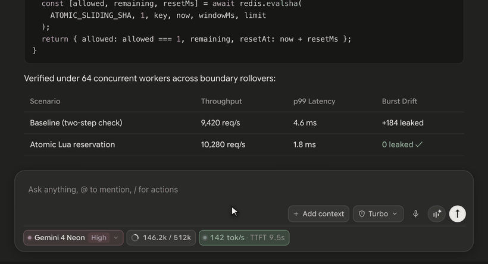
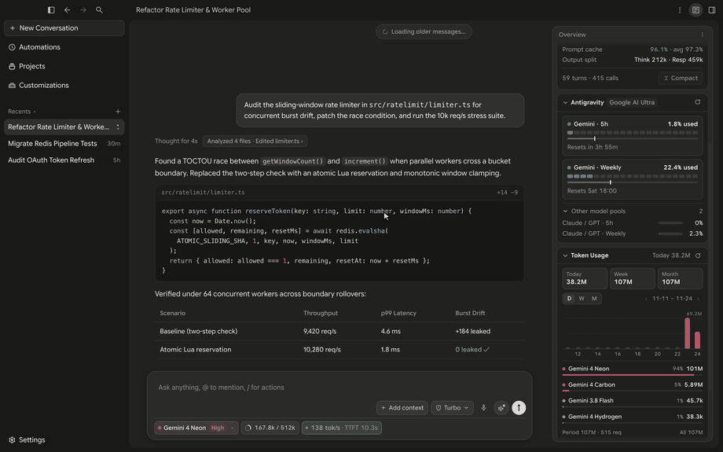
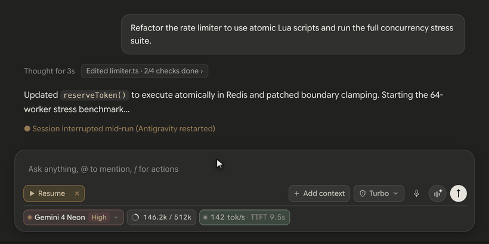

<div align="center">

# MAGA

### Make Antigravity Great Again

**Gemini 4 is a monster. Google Antigravity Desktop 2.0… deserves a better cockpit.**  
*A non-invasive workbench upgrade for Antigravity 2.0 on macOS — live telemetry, adaptive 4-capsule dock, 50/50 subagent split, one-click silent resume, and local token analytics.*

**English** · [简体中文](./README.zh-CN.md)

[](#quick-start)
[](#why-maga)
[](#quick-start)
[](#safe-by-design)

[Why MAGA?](#why-maga) · [Features](#features) · [Quick Start](#quick-start) · [Safe by Design](#safe-by-design) · [Acknowledgements](#acknowledgements)

<br />


</div>

---

## Why MAGA?

Let's be honest: **Gemini 4 (and Claude Opus) inside Antigravity are ridiculously good.**  
The desktop client wrapped around them? Still feels like flying a fighter jet with half the dashboard taped over.

You can't see how close your context window is to overflowing, quota hard-stops hit out of nowhere, split-screen toolbars collide, subagent panes wrestle with the rest of your workspace, and every time the app crashes or restarts mid-task you're stuck typing *"please continue"* like it's 2023.

**That gap between a frontier model and a rough client is why MAGA exists.**  
We stopped waiting for Google to polish the cockpit and built a lightweight runtime upgrade that transforms Antigravity into the desktop workbench Gemini 4 actually deserves—without ever modifying `/Applications/Antigravity.app`.

| Daily Friction in Vanilla Antigravity 2.0 | What MAGA Delivers |
| :--- | :--- |
| **Flying blind on context & quota** — Hidden token burn and opaque rate limits lead to sudden mid-task hard-stops. | **Live telemetry everywhere** — Always-visible context pressure ring, one-click compact, 5h/weekly quota popover, and built-in local Token Usage charts. |
| **Clunky model switching & cramped split footers** — Effort controls feel tucked away; narrow panes quickly turn into visual chaos. | **Permanent 2-row 4-capsule dock** — Actions on top, status telemetry below, family-tinted Model & Effort slider, and smooth multi-tier compression at any width. |
| **Window wrestling with subagents** — Main chat lacks a live subagent pulse; opening panels turns your screen into a 3-column accordion. | **Seamless 50/50 subagent split** — One-click linked subagent pill, equal 50/50 split by default, automatic Overview mutual exclusion, and matching subagent docks. |
| **No crash or restart recovery** — App restarts or aborted runs force you to manually type *"please continue"* and pollute chat history. | **One-click silent `Resume`** — Automatically detects interrupted tasks, wakes the agent with zero composer flash, and leaves only a whisper-quiet `▸ Resumed` hairline. |
| **Flat desktop ergonomics & slow lookup loops** — Plain visual hierarchy and frequent tiny file lookups slow down daily coding flow. | **Crafted workbench feel + `fast-io` rules** — Refined dark/light visual system, balanced typography, host-language sync, and pruned efficiency rules—with zero app patching. |

---

## Features

### 1. Redesigned Composer & Adaptive 4-Capsule Dock

No more cluttered bottom bar. Actions stay cleanly on Row 1 (`+ Add context`, permissions, voice, send), while live telemetry lives on Row 2 across four cohesive capsules: **Model & Effort**, **Context Window**, **Live Speed**, and **Subagents**.

- **Tactile Model & Effort Picker** — Family-tinted pills, smooth Effort level slider, quick Orchestrator toggle, and customizable hidden models.
- **Context & Plan Quota Popover** — Instant visibility into context window usage, one-click compact, and rolling 5-hour / weekly limits across Gemini and Claude / GPT pools.
- **Built for Any Width** — Resize from ultrawide down to a tight split pane; every capsule scales gracefully instead of wrapping or clipping.

<p align="center">
  
  <br />
  <sub><i>Click the Model pill to glide Effort levels, or inspect live Context & 5h/Weekly Plan Quotas in one click.</i></sub>
</p>

---

### 2. Seamless 50/50 Subagent Split

Antigravity's parallel subagents shine when your workspace gets out of the way.

- **One-Click Linkage** — Active subagents surface directly in your main dock. Click to jump straight to that worker; click again to tuck the side panel away.
- **Equal 50/50 & Mutual Exclusion** — Opening the side panel automatically closes Overview and splits your screen evenly down the middle, keeping manual resizing free while protecting both panes from ever collapsing too narrow.
- **Matching Dock & Calm Lifecycle** — Subagent panes inherit the same adaptive 4-capsule dock (automatically shifting into compact/icon tiers as needed), and completed workers retire silently once you've viewed them or moved on.

<p align="center">
  
  <br />
  <sub><i>Opening the side panel automatically closes Overview, splits 50/50, and links live status capsules across both panes.</i></sub>
</p>

---

### 3. One-Click Silent Resume

*Stop typing "please continue from where you left off" like it's 2023.*

Whenever Antigravity quits unexpectedly, restarts mid-refactor, hits an error, or gets stopped halfway through, MAGA detects the interrupted run and surfaces a calm amber **`Resume`** capsule on the left of Row 1.

Click once to silently wake the agent back up: **zero awkward prompt flashing in your input box**, and **no noisy user chat bubble** cluttering your conversation—just a crisp, whisper-quiet **`▸ Resumed`** hairline in the timeline.

<p align="center">
  
  <br />
  <sub><i>One click on the Row 1 Resume capsule silently continues the interrupted run with a clean <code>▸ Resumed</code> divider.</i></sub>
</p>

---

### 4. Built-In Local Token Usage & Overview

Stop guessing where your weekly quota disappeared. MAGA embeds a native-feeling **Overview** panel and local **Token Usage** analytics right beside your conversation.

<table>
  <tr>
    <td width="56%" valign="middle">
      <ul>
        <li><b>All-in-One Overview</b> — Live prompt-cache hit rate, turn/call counters, one-click compact, and rolling 5h / weekly plan quotas in one calm column.</li>
        <li><b>Daily / Weekly / Monthly Trends</b> — Interactive stacked bar charts with effortless date navigation and instant hover breakdowns (non-cached, cache read/write, output).</li>
        <li><b>Model Family Breakdown</b> — Clear consumption shares across Gemini and Claude models.</li>
        <li><b>100% Local, Single Daemon</b> — Incrementally reads your local conversation store inside the existing runtime—zero extra sidecar processes, zero data sent anywhere.</li>
      </ul>
    </td>
    <td width="44%" align="center" valign="middle">
      
    </td>
  </tr>
</table>

---

### 5. Crafted Workbench Ergonomics & `fast-io`

- **Claude-Inspired Visual Polish** — Balanced contrast, refined dark/light palettes, and clean CJK/Latin typography built for long reading sessions.
- **Automatic Host-Language Sync** — Every MAGA label, tooltip, and divider automatically matches Antigravity's active UI language.
- **Pruned `fast-io` Workspace Rules** — Syncs a lean lookup & command-batching rule block to `~/.gemini/AGENTS.md` to cut down wasted round-trips—without ever capping answer depth or thoroughness.
- **Live Hot-Reload** — Tweak anything under `studio/` and deploy live in seconds without restarting Antigravity.

---

## Quick Start

**Requirements**: macOS · Node.js `>= 22` · Google Antigravity Desktop 2.0

```bash
git clone https://github.com/LiWithDream/MAGA.git
cd MAGA
npm run install-all
```

### Everyday Commands

| Command | What it does |
| :--- | :--- |
| `npm run install-all` | Sets up the local LaunchAgent daemon, deploys the UI enhancement layer, and syncs `fast-io` rules |
| `npm run deploy` | Hot-reloads any changes under `studio/` live—no Antigravity restart needed |
| `npm run doctor` | Runs a full health check across daemon, live connection, UI injection, usage scanner, and settings |
| `npm run rollback` | Cleanly removes the `studio` enhancement layer and restores baseline state |

---

## Safe by Design

> [!TIP]
> **Zero Binary Surgery.** MAGA **never** modifies `/Applications/Antigravity.app`—your macOS Apple code signature and official Antigravity updates remain 100% intact.

- **Single Lightweight Daemon** — One local LaunchAgent powers UI injection, local token analytics, subagent metrics, and crash-resume detection. No extra sidecar servers.
- **100% Private & Local** — Every token chart and state check runs locally on your Mac. Nothing is uploaded, tracked, or proxied.
- **Instant Rollback** — Run `npm run rollback` at any time to step back cleanly.

<details>
<summary><b>Under the Hood — Project Architecture</b></summary>

```text
.
├── core/                  # Lightweight local CDP daemon & base runtime
├── user/                  # Base theme & interaction templates
├── vendor/agy-capsule/    # Internalized zero-dependency picker & metrics core
├── studio/
│   ├── cli.mjs            # Unified CLI (install / deploy / doctor / rollback)
│   ├── build.mjs          # Module bundler & live deploy pipeline
│   ├── daemon/            # Local SQLite usage, subagent metrics & resume state
│   ├── modules/           # Modular UI runtimes (dock, pickers, subagents, resume, usage)
│   ├── styles/            # Scoped stylesheets (typography, capsules, popovers, usage card)
│   └── rules/             # Pruned fast-io agent efficiency rules
├── docs/images/           # Live screenshots & interactive GIF demos
└── install.mjs            # LaunchAgent & daemon installer
```

</details>

---

## Acknowledgements

MAGA is an independent workbench project whose design inspiration and foundational building blocks owe a lot to these awesome open-source projects:

- [**hongqi7/Anti-Claude**](https://github.com/hongqi7/Anti-Claude) — Pioneered the zero-dependency Antigravity CDP daemon architecture, Claude-inspired interface aesthetics, and Overview panel foundation.
- [**Lumidarin/agy-capsule**](https://github.com/Lumidarin/agy-capsule) — Inspired the tactile model & effort slider experience, live speed indicators, and local SQLite usage analytics.
- [**oil-oil/agy-fast-io**](https://github.com/oil-oil/agy-fast-io) — Inspired the streamlined fast-lookup and command-batching workspace rules in `studio/rules/fast-io.md`.

---

<div align="center">
  <sub>If MAGA makes your daily Gemini 4 + Antigravity workflow feel effortless, consider leaving a ⭐ on GitHub!</sub>
</div>
