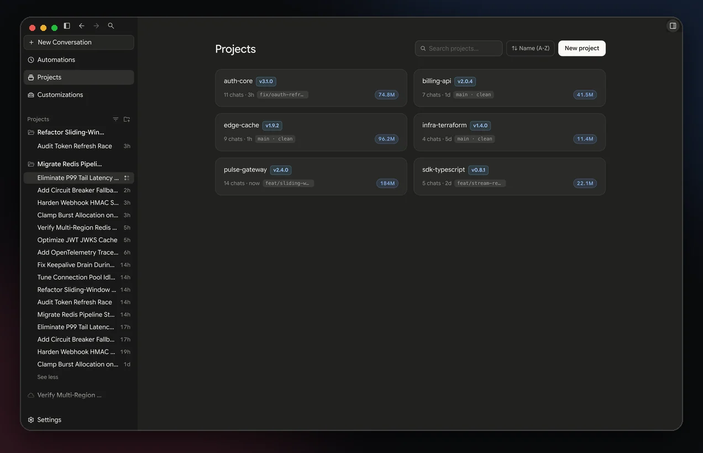
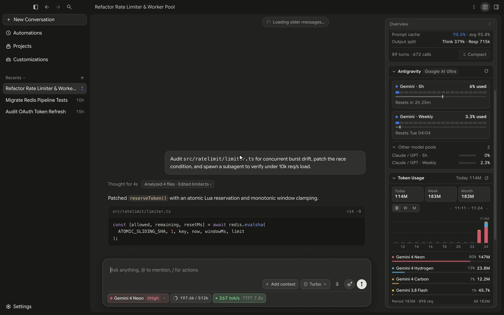

<div align="center">

# AGY Studio

**Run Antigravity like an engineering team.**  
Give every conversation its own Git worktree, bring in Claude Opus for a second opinion at the moments that matter, and keep every project's tokens, quota, and context under control.

**English** · [简体中文](./README.zh-CN.md)

[](https://github.com/LiWithDream/agy-studio/stargazers)
[](https://github.com/LiWithDream/agy-studio/releases)
[](#limitations--platform-support)
[](#core-capabilities)
[](./LICENSE)

Install in 10 seconds: paste one prompt into Antigravity → **[Quick Start](#quick-start)**

[What's Different](#native-antigravity-vs-agy-studio) · [Core Capabilities](#core-capabilities) · [Quick Start](#quick-start) · [Safe & Fast](#safe--fast-by-design) · [Compatibility](#compatibility)

<br />



<sub><i>Switch across projects, inspect uncommitted diffs with one-click <code>@file</code> context, check per-project token spend, and live-preview settings — all in one window.</i></sub>

</div>

---

## Native Antigravity vs. AGY Studio

Antigravity Desktop 2.0 is built around **one agent in one chat**. Once you juggle multiple repos, parallel branches, long sessions, and tight Claude/Gemini quotas, **AGY Studio** upgrades it into a full engineering workspace:

| Daily Engineering Job | Native Antigravity | With AGY Studio |
| :--- | :--- | :--- |
| **Work across multiple repos & parallel tasks** | Chats share one working tree; uncommitted changes and branches are easy to lose track of | Isolated Git worktree per conversation, tiered branch guardrails, live diffs & one-click `@file` context |
| **Review plans, risky diffs & stubborn bugs** | Manually copy context into another model — or ship unreviewed | One-click or automatic Claude Opus second-opinion checkpoints at `plan`, `risk`, `debug`, and `stop` |
| **Track per-project spend & 5h/weekly pools** | Token spend by project and dual-pool headroom take digging to piece together | Real-time Gemini & Claude/GPT 5h/weekly pools, cache hit rate, and per-project Day/Week/Month charts |
| **Keep long sessions sharp before context rot** | Manual `/compact` after responses already start degrading | Cache-aware Auto-Compact at configurable thresholds or before scheduled waits, protecting drafts |
| **Run long tasks & subagents without babysitting** | Subagents stay tucked in drawers; interrupted runs require manual reprompting | Instant 50/50 subagent split from the dock, one-click silent `Resume`, folded noise & disciplined turns |
| **Customize models, dock & interface language** | Fixed bar, no effort presets, English-only UI | Per-family effort sliders, custom model filter, live 3-tab Settings Studio & built-in Chinese UI |

---

## Core Capabilities

### 1. Parallel Multi-Project Engineering

**Run multiple repos and agent tasks side by side — without branch collisions or context switching.**


- **Isolated Worktrees & Branch Guardrails**: Bind a dedicated Git worktree to each conversation from the workspace or top bar, and enforce per-repo branch policies (`observe` / `protect-main` / `worktree-only`) plus force-push protection — centrally in Settings, with zero config files polluting your repos.
- **Actionable Git Context Inline**: See which repos have uncommitted changes before you prompt. Expand dirty files or recent commits right inside the project view, insert `@file` with one click, or trigger `Review changes` and `Draft commit` immediately.
- **Instant Project Cockpit & Cold-Start Pickup**: Sort projects by recent activity, token cost, or name, read `AGENTS.md` and recent chats with per-chat spend badges, and optionally generate 3 context-aware next-step starter pills grounded in your recent Git commits and last 5 conversations.

<details>
<summary><b>More visuals &amp; how it works</b></summary>
<br />
<p align="center">
  
</p>
<ul>
  <li><b>Zero-config worktree CLI</b>: Also includes a universal <code>wt</code> CLI (<code>wt.mjs</code>) and optional local Git hooks so terminal workflows and agent sessions follow the same branch policy.</li>
  <li><b>Optional AI next-step suggestions</b>: Bring your own Google AI Studio key (stored locally, owner-only permissions) to power Gemini 3.8 Flash starter suggestions — completely off by default.</li>
</ul>
</details>

---

### 2. Cross-Model Review Gate (Opus Gate)

**Let fast models build at full speed — bring in Claude Opus as an independent reviewer at the moments where mistakes are expensive.**

| Checkpoint | When It Fires | What Opus Checks |
| :--- | :--- | :--- |
| **`plan`** | Finalizing a multi-module architecture or complex plan | Hidden coupling, missing edge cases, flawed assumptions before code is written |
| **`risk`** | High-risk diffs (auth, state machines, locking, migrations) | Concurrency races, security regressions, subtle invariant breaks |
| **`debug`** | Stuck after repeated failed attempts | Fresh root-cause analysis without getting trapped in the same tunnel vision |
| **`stop`** | Wrapping up a complex multi-step change | Final pre-ship diff audit before you commit or merge |

- **You Control the Autonomy**: Defaults to **Semi-auto** — surfaces a clean one-click review pill in the bottom dock whenever a checkpoint triggers. Switch to **Auto** to dispatch a read-only Opus review via `/swarm` automatically.
- **Protects Your Subscription Under the Hood**: Built-in quota guardrails monitor your Claude 5-hour and weekly pools, automatically stepping down tiers or pausing before a review can unexpectedly drain your limit.

---

### 3. Tokens, Quota & Context Under Control

**See exactly where every token goes and keep long sessions sharp — before you hit a lockout or context degradation.**


- **Dual-Pool Quota & Cache Transparency**: Track Gemini and Claude/GPT 5-hour and weekly headroom side by side in the Overview sidebar or context-ring popover, alongside live prompt cache hit rate and thinking-vs-response output split.
- **Per-Project & Per-Chat Cost Clarity**: Native Day / Week / Month stacked charts break down uncached input, cache reads/writes, output tokens, and share of total usage across every project and conversation.
- **Cache-Aware Auto-Compact**: Automatically or semi-automatically compacts context at configurable thresholds — or right before long scheduled waits while your prompt cache is still hot — without ever clobbering an unsent draft.

<details>
<summary><b>Interactive demo: model effort slider &amp; dual-pool quota popover</b></summary>
<br />
<p align="center">
  
</p>
</details>

---

### 4. Long Runs Without Babysitting

**Kick off complex multi-agent runs and stay in flow — without babysitting subagent drawers, dropped streams, or verbose tool noise.**

<table>
  <tr>
    <td width="50%" align="center" valign="top">
      
      <br /><sub><i>One-click 50/50 subagent split from the bottom dock</i></sub>
    </td>
    <td width="50%" align="center" valign="top">
      
      <br /><sub><i>Silent one-click Resume after mid-stream interruptions</i></sub>
    </td>
  </tr>
</table>

- **Instant 50/50 Subagent Split**: Whenever subagents launch, a live dock pill pulses while running and turns emerald when done. Click once for a clean 50/50 split view (automatically tucking redundant sidebars away); click again to fold back.
- **Silent One-Click `Resume`**: Detects mid-stream interruptions and displays a subtle contextual `Resume` pill that continues cleanly from the breakpoint without flashing template text in your input box.
- **Higher Signal, Fewer Wasted Turns**: Fold verbose thinking prose and 40+ line code blocks with sticky copy headers, monitor live generation speed & TTFT, and optionally sync distilled `fast-io` rules that cut redundant file-read loops without capping final answer depth.

---

## Quick Start

**Requirements**: macOS (Apple Silicon or Intel) · Node.js `>= 22` · Google Antigravity Desktop 2.0

### Recommended: Let Antigravity or Claude Code Install It for You

Paste this prompt directly into Antigravity or Claude Code:

```text
Clone https://github.com/LiWithDream/agy-studio.git to ~/Developer/agy-studio, read docs/INSTALL_AGENT.md, run bash ./install.sh, and verify with node studio/cli.mjs doctor. Do not touch /Applications/Antigravity.app or delete existing chats.
```

> **Safe by design**: Never modifies `/Applications/Antigravity.app`, keeps all data local, and reverts cleanly at any time with `bash ./uninstall.sh` → [See how it works](#safe--fast-by-design).

<details>
<summary><b>Alternative install methods (Prebuilt tarball / From source / Uninstall &amp; Diagnostics)</b></summary>

#### Prebuilt Release Tarball (No `npm install` Required)

Download the latest `agy-studio-v*-macos.tar.gz` from [Releases](https://github.com/LiWithDream/agy-studio/releases) and run:

```bash
tar -xzf agy-studio-v*-macos.tar.gz && cd agy-studio-v*-macos
bash ./install.sh
```

#### Install from Source

```bash
git clone https://github.com/LiWithDream/agy-studio.git ~/Developer/agy-studio
cd ~/Developer/agy-studio
bash ./install.sh
```

Pass `--no-rules` if you prefer not to sync the optional `fast-io` rules into `~/.gemini/AGENTS.md`.

#### Everyday Commands

| Command | What It Does |
| :--- | :--- |
| `node studio/cli.mjs doctor` | Verify daemon health, CDP attachment, plugin status, usage scanner, and proxy forwarding |
| `bash ./uninstall.sh` | Cleanly remove the UI layer, background daemon, and synced rules while keeping all chats & preferences |

</details>

---

## Craft & Ergonomics

Small daily friction adds up when you live inside Antigravity all day — every piece is modular and toggleable:

<table>
  <tr>
    <td width="52%" valign="top">
      <ul>
        <li><b>Live 3-Tab Settings Studio</b> — Toggle any module, preview slider and dock themes in real time, export/import JSON configs, or reset cleanly to defaults.</li>
        <li><b>Adaptive Dock &amp; Model Effort Sliders</b> — Separates actions from live telemetry so narrow split panes stay crisp; switch reasoning tiers directly inside the model picker, hide unused models, and set a persistent Orchestrator executor model.</li>
        <li><b>Built-in Chinese UI &amp; macOS Typography</b> — Toggle Simplified Chinese UI localization and optical CJK font scaling right from Settings — no ASAR patching required.</li>
        <li><b>Flexible Sidebar Recents</b> — Optionally merge project groups into one unified chronological conversation list.</li>
      </ul>
    </td>
    <td width="48%" align="center" valign="middle">
      
    </td>
  </tr>
</table>

---

## Safe & Fast by Design

**Will this break Antigravity updates, slow down streaming, or send my data anywhere?** No.

- **Zero `.app` Modifications**: Runs purely through a single local macOS `LaunchAgent` and Chrome DevTools Protocol (CDP) runtime layer. `/Applications/Antigravity.app` stays completely untouched — macOS code signature and auto-updates continue working normally.
- **100% Local & Reversible**: Token analytics query Antigravity's local SQLite state read-only (`immutable=1`). Nothing is uploaded to external servers (optional AI suggestions only call Google AI Studio if you explicitly provide your own key). Run `bash ./uninstall.sh` anytime to revert cleanly.
- **Engineered for Zero UI Lag**: Built around a single shared DOM observer with self-mutation isolation, leaf-only telemetry updates, and automated CSS/DOM regression guards.

| Verified Engineering & Safety Metrics | Measured Baseline |
| :--- | :--- |
| Changes to `/Applications/Antigravity.app` | **`0 bytes`** (signature & auto-updates intact) |
| Root DOM observers (`MagaKernel`) | **`1`** shared `MutationObserver` (`data-maga-own` filtered) |
| Frame flush cost (Apple Silicon local CDP check) | **`1.5–3.6 ms`** with leaf-only telemetry slots (`MetricsBus`) |
| Global CSS `:has()` selectors | **`0`** (enforced by automated test guards) |
| Automated regression & invariant suite (`npm test`) | **`175+`** passing tests, **`0`** skipped |
| Background footprint | **`1`** local macOS `LaunchAgent` |

---

## Compatibility

Running other Antigravity plugins? Here is how **AGY Studio** behaves alongside them:

| Tool / Plugin | Relationship | Notes |
| :--- | :--- | :--- |
| **`INK-Q/agy-fast`** | **Compatible** | Complementary MCP tool accelerator; runs cleanly alongside AGY Studio's UI layer. |
| **`oil-oil/agy-fast-io`** | **Rule overlap** | AGY Studio includes a distilled `fast-io` rule block; pass `bash ./install.sh --no-rules` if you prefer standalone `agy-fast-io`. |
| **`Lumidarin/agy-capsule`** | **Dock overlap** | AGY Studio integrates `agy-capsule` (`MIT`) directly in `vendor/agy-capsule/`. Do not run a separate copy at the same time. |
| **`WhiteBr1ck/agy-powertools`** | **UI layer overlap** | Both inject into Antigravity's CDP UI layer. Choose one, or run `bash ./uninstall.sh` before switching. |
| **External ASAR CN patches** | **Not co-tested** | AGY Studio already includes a built-in Chinese UI toggle without touching `app.asar`. |

---

## Limitations & Platform Support

- **macOS-only for now**: Daemon lifecycle and CDP bootstrap currently rely on macOS `LaunchAgent` and `/usr/bin/open`. Windows and Linux support are tracked on GitHub Issues — upvote to help prioritize.
- **Agent rules are guidance, not hard locks**: Optional `fast-io` rules in `~/.gemini/AGENTS.md` significantly reduce wasted tool turns, though models may occasionally deviate.
- **No multi-account OAuth relay**: AGY Studio focuses on single-workspace engineering ergonomics, Git worktree isolation, cross-model review, and usage clarity — it does not proxy APIs or rotate multiple Google accounts.

---

## Settings Reference

<details>
<summary><b>All configurable options inside AGY Studio Settings (live preview + persistent JSON)</b></summary>

| Category | Option | Default | What It Controls |
| :--- | :--- | :--- | :--- |
| **Models & Thinking** | Effort Bar & Model Dots | `On` | Interactive effort slider, brand dots, promo badge cleanup, Orchestrator toggle |
| **Models & Thinking** | Slider & Orchestrator Themes | `Follow` | Per-family motion themes (`Physical`/`Ribbon`/`Nebula`, `Matrix`/`Verse`/`Spark`, `Codex`) |
| **Models & Thinking** | Default Tier by Family | `Neon: High` | Initial effort tier when switching model families |
| **Models & Thinking** | Hidden Models Filter | `All shown` | Hide unused models from the bottom capsule picker |
| **Models & Thinking** | Opus Review Gate (`Opus Gate`) | `Semi-auto` | Mode (`Off`/`Semi-auto`/`Auto`), tier (`High`/`Med`), 5h/weekly quota floors, `plan`/`risk`/`debug`/`stop` toggles |
| **Models & Thinking** | Orchestrator Executor | `System Default` | Persistent execution model override when Orchestrator is enabled |
| **Conversation** | Hide Thinking Prose | `On` | Collapse verbose Thought bodies and chevrons |
| **Conversation** | Step Stream Mode | `Compact` | Unified step verbosity and fold state |
| **Conversation** | Interrupted Resume Pill | `On` | Contextual `Resume` pill for mid-stream interruptions |
| **Conversation** | Cache-Aware Auto-Compact | `Semi-auto` | Mode (`Off`/`Semi-auto`/`Auto`), context threshold (`50%`), long-wait triggers |
| **Conversation** | Long Code Folding | `On` | Collapse code blocks over 40 lines with sticky copy header |
| **Workspace** | Overview & Project Usage | `On` | Right-hand Overview and per-project Day/Week/Month token charts |
| **Workspace** | Subagent Dock Pill | `On` | Footer subagent status pill and one-click 50/50 split |
| **Workspace** | Context Ring & Quota Popover | `On` | Real-time context usage ring and 5h/weekly dual-pool popover |
| **Workspace** | Unified Sidebar Recents | `Off` | Optionally merge native project groups into one chronological list |
| **Workspace** | Git Workflow Policy | `Observe` | Per-repo `observe` / `protect-main` / `worktree-only` guardrails + force-push block |
| **Workspace** | AI Chat Suggestions | `Off` (key optional) | Gemini 3.8 Flash next-step starter pills from Git history + last 5 chats |
| **Appearance** | Chinese UI Localization | `Off` | Built-in Simplified Chinese UI toggle + CJK optical scale (`94.5%` / `95%` / `100%`) |
| **Appearance** | Motion Intensity | `Full` | `Full` / `Reduced` / `Off` animation control |

</details>

---

## Troubleshooting

### `Error Loading Models` / `loadCodeAssist: EOF`

This comes from Antigravity's native `language_server` when its TLS/proxy connection to `daily-cloudcode-pa.googleapis.com` drops; it is not caused by AGY Studio's UI layer.

1. Enable **TUN mode** or **System Proxy** in your proxy client (Clash / Mihomo / Surge / V2Ray) so `*.googleapis.com` routes through a stable node.
2. **Automatic proxy forwarding**: When launching Antigravity from a shell with proxy or custom CA variables (`HTTP_PROXY`, `HTTPS_PROXY`, `ALL_PROXY`, `NO_PROXY`, `SSL_CERT_FILE`, `NODE_EXTRA_CA_CERTS`) or `--proxy-*` flags, AGY Studio preserves and forwards them during macOS CDP auto-relaunch. Run `node studio/cli.mjs doctor` to inspect `proxyDiagnostics`.
3. To manage `--remote-debugging-port=0` manually instead of automatic relaunch, start the daemon with `ANTI_CLAUDE_NO_CDP_BOOTSTRAP=1`.

---

## Architecture & Contributing

<details>
<summary><b>Directory layout &amp; contributor commands</b></summary>

```text
.
├── core/                  # Local CDP daemon + submodules (attach, bootstrap, SQLite, projects, worktrees)
├── user/src/              # 21 modular ESM frontend files (<2,000 lines each, compiled to user/custom.js)
├── vendor/agy-capsule/    # Vendored MIT model/effort picker, motion themes & SQLite parser
├── studio/
│   ├── core/              # MagaKernel (1 root observer), DomFlags, MetricsBus, snapshot
│   ├── shared/            # Single-source preferences schema & sanitization
│   ├── daemon/            # Usage stats, resume detection, AI suggestions, plugin sync & gate services
│   ├── modules/           # Dock capsules, 3-tab Settings Studio, auto-compact, subagent split
│   ├── plugin/            # Managed plugins (maga-opus-gate, maga-auto-compact, maga-git-workflow)
│   ├── styles/            # Scoped stylesheets (0 :has() selectors)
│   ├── cli.mjs            # Unified CLI (install / deploy / sync-rules / doctor / rollback)
│   └── pack-release.mjs   # Zero-npm-install Release tarball packager
├── test/                  # Automated regression & invariant suite (175+ tests)
├── install.sh             # One-line macOS installer (--dry-run, prebuilt & source modes)
└── uninstall.sh           # Clean rollback & uninstaller (--dry-run supported)
```

| Contributor Command | Purpose |
| :--- | :--- |
| `npm run wt:new -- feat/slug` | Create an isolated sibling Git worktree with symlinked `node_modules` |
| `npm test` | Compile `user/custom.js` and run the full 175+ test & invariant suite |
| `npm run deploy` | Hot-reload UI changes into running Antigravity from clean `main` (no app restart) |
| `npm run release:pack` | Build a zero-`npm-install` macOS tarball + SHA-256 checksum in `dist/` |

</details>

---

## Acknowledgements

AGY Studio builds on and integrates ideas and MIT-licensed code from these community projects:

- [**hongqi7/Anti-Claude**](https://github.com/hongqi7/Anti-Claude) — Provided the zero-`.app`-patch Antigravity CDP daemon foundation (`core/`), Claude-style visual tokens, Overview panel base, and context/quota popover scaffolding.
- [**Lumidarin/agy-capsule**](https://github.com/Lumidarin/agy-capsule) (MIT License) — Vendored in `vendor/agy-capsule/` for the enhanced model & effort picker, motion themes, speed/TTFT telemetry, and local SQLite usage parsing.
- [**LLYSH-HANNARI/antigravity-Codex-Claude-effort-slider**](https://github.com/LLYSH-HANNARI/antigravity-Codex-Claude-effort-slider) (MIT License) — Introduced via `agy-capsule` for per-family animated effort slider tracks and direct React tree model/tier commits.
- [**oil-oil/agy-fast-io**](https://github.com/oil-oil/agy-fast-io) — Contributed the `grep`-first batched reading and approval-free read-only command discipline distilled into `studio/rules/fast-io.md`.

<sub><i>Previously published as MAGA.</i></sub>

---

<div align="center">
  <sub>MIT Licensed · If AGY Studio helps you ship faster on Antigravity Desktop 2.0, consider leaving a ⭐ — or upvote Windows support in Issues.</sub>
</div>
