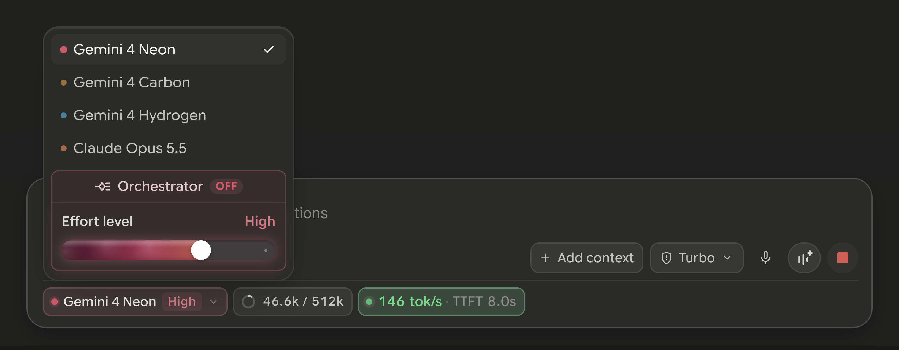
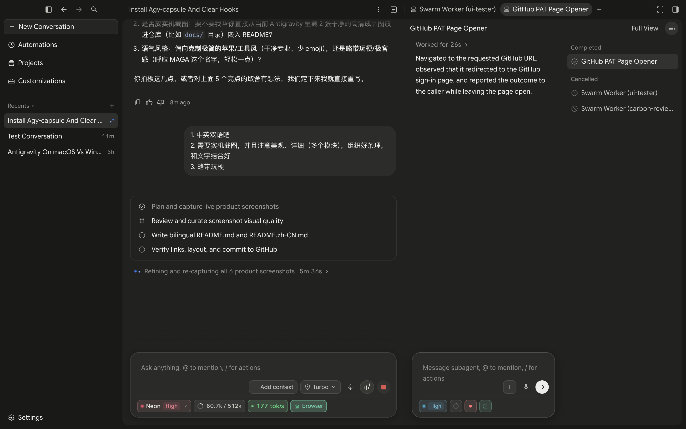
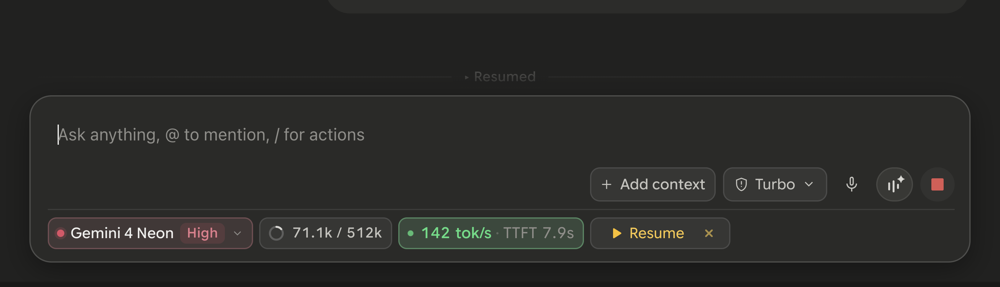

<div align="center">

# MAGA — Make Antigravity Great Again

**The unofficial workbench upgrade for Google Antigravity Desktop 2.0 on macOS.**  
*Zero app patching. Zero broken Apple signatures. Huge UX gains.*

**English** · [简体中文](./README.zh-CN.md)


<br />


</div>

---

## Why MAGA?

Google Antigravity 2.0 has serious horsepower under the hood, yet daily power-use still hits plenty of paper cuts: cramped bottom toolbars in split view, noisy thinking walls, disappearing subagent context, and typing *"please continue"* like it's 2023 every time the app restarts mid-task.

**MAGA** fixes the everyday ergonomics through a single lightweight local runtime—leaving `/Applications/Antigravity.app` completely untouched, preserving macOS code signing, hot-reloading in seconds, and rolling back cleanly whenever you want.

---

## What's Inside

### 1. Redesigned Composer & Adaptive 4-Capsule Dock

Actions stay on top; live telemetry sits cleanly underneath. The permanent two-row footer brings together **Model & Effort**, **Context Window**, **Live Speed**, and **Subagents** in one cohesive dock—paired with an inline `+ Add context` button that stays out of your way.

Drag your window wide or squeeze it into a tight split: every capsule compresses smoothly through progressive tiers instead of wrapping, clipping, or playing hide-and-seek.

<table>
  <tr>
    <td width="50%" valign="top">
      
      <p align="center"><sub><b>Model & Effort Picker</b> — Family-tinted pills, animated effort slider, Orchestrator toggle, and customizable hidden models.</sub></p>
    </td>
    <td width="50%" valign="top">
      
      <p align="center"><sub><b>Context & Quota Popover</b> — Context pressure alerts, one-click compact, and 5-hour / weekly plan limits at a glance.</sub></p>
    </td>
  </tr>
</table>

---

### 2. Seamless 50/50 Subagent Split

Working with subagents shouldn't feel like wrestling window panes.

- **One-Click Linkage**: Click a subagent pill in the main dock to jump straight to that worker—or click again to tuck the side panel away.
- **Equal 50/50 by Default**: Opening the auxiliary pane automatically splits your workspace down the middle while keeping manual resizing free and protecting both panes from ever collapsing too narrow.
- **Automatic Mutual Exclusion**: Opening the Subagent pane neatly closes Overview (and vice versa), so your workspace never turns into a three-column accordion.
- **Matching Dock & Calm Lifecycle**: Subagent composers get the same adaptive 4-capsule dock; finished workers fade out automatically once you've checked them or moved on to your next turn.



---

### 3. One-Click Silent Resume

App crashed? Restarted mid-refactor? Stopped a run halfway through?

MAGA automatically detects interrupted conversations and surfaces a calm **`Resume`** capsule right in the composer. One click silently wakes the agent back up—no awkward prompt flashing in the input box, and no bulky *"please continue from where you left off"* chat bubble cluttering your history. Just a whisper-quiet **`▸ Resumed`** hairline divider in the timeline.

<p align="center">
  
</p>

---

### 4. Built-In Local Token Usage

Know where your tokens actually go without spinning up another background service or shipping data anywhere.

<table>
  <tr>
    <td width="56%" valign="middle">
      <ul>
        <li><b>Native Overview Integration</b> — Lives directly inside the right-hand Overview panel alongside your live plan quotas.</li>
        <li><b>Daily / Weekly / Monthly Trends</b> — Interactive stacked bar charts with effortless date-range navigation and instant hover breakdowns.</li>
        <li><b>Per-Model Distribution</b> — Clear share bars across Gemini and Claude model families.</li>
        <li><b>100% Local & Single-Daemon</b> — Reads your local conversation store incrementally inside the existing runtime—zero extra sidecar processes.</li>
      </ul>
    </td>
    <td width="44%" align="center" valign="middle">
      
    </td>
  </tr>
</table>

---

### 5. Focused Reading & Zero-Intrusion Craft

- **Quieter Timeline**: Replaces sprawling raw thinking walls with a crisp single-line `Thought for Xs` status, and keeps verbose tool groups collapsed until you actually want to inspect them.
- **Balanced Typography**: Cleaner weight, contrast, and CJK/Latin visual harmony across dark and light modes, with automatic alignment to Antigravity's active UI language.
- **Faster Agent I/O**: Bundles a pruned `fast-io` rule set for `~/.gemini/AGENTS.md` to cut down wasted lookup round-trips—without ever capping answer depth or thoroughness.
- **Zero Binary Surgery**: Never touches `/Applications/Antigravity.app`. Hot-deploy changes live without restarting, and roll back cleanly with a single command.

---

## Quick Start

**Requirements**: macOS · Node.js `>= 22` · Google Antigravity Desktop 2.0

```bash
# 1. Full install (sets up the local LaunchAgent daemon, deploys UI enhancements & syncs fast-io rules)
npm run install-all

# 2. Hot-reload after editing anything in studio/ (no Antigravity restart needed)
npm run deploy

# 3. Health check (daemon, live connection, injection status, local usage scanner & key settings)
npm run doctor

# 4. Roll back the studio enhancement layer cleanly
npm run rollback
```

<details>
<summary><b>Under the Hood — Project Layout</b></summary>

```text
.
├── core/                  # Lightweight local CDP daemon & base runtime
├── user/                  # Base theme & interaction templates
├── vendor/agy-capsule/    # Internalized zero-dependency picker & metrics core
├── studio/
│   ├── cli.mjs            # Unified CLI (install / deploy / doctor / rollback)
│   ├── build.mjs          # Module bundler & live deploy pipeline
│   ├── daemon/            # Local SQLite usage, subagent metrics & resume state
│   ├── modules/           # Modular UI runtimes (dock, pickers, subagents, resume, usage)
│   ├── styles/            # Scoped stylesheets (typography, capsules, popovers, usage card)
│   └── rules/             # Pruned fast-io agent efficiency rules
├── docs/images/           # Live product screenshots
└── install.mjs            # LaunchAgent & daemon installer
```

</details>

---

## Acknowledgements

MAGA is an independent workbench project whose design inspiration and foundational ideas owe a great deal to these awesome open-source projects:

- [**hongqi7/Anti-Claude**](https://github.com/hongqi7/Anti-Claude) — Pioneered the zero-dependency Antigravity CDP daemon architecture, Claude-inspired interface aesthetics, and Overview panel foundation.
- [**Lumidarin/agy-capsule**](https://github.com/Lumidarin/agy-capsule) — Inspired the tactile model & effort slider experience, live speed indicators, and local SQLite usage analytics.
- [**oil-oil/agy-fast-io**](https://github.com/oil-oil/agy-fast-io) — Inspired the streamlined fast-lookup and command-batching workspace rules in `studio/rules/fast-io.md`.
