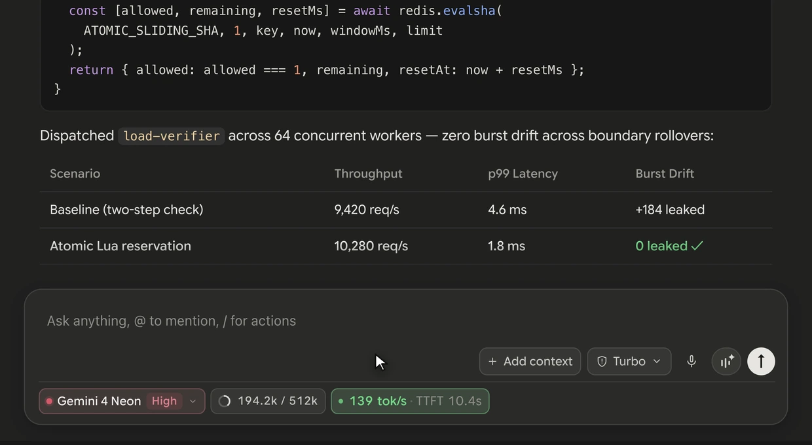
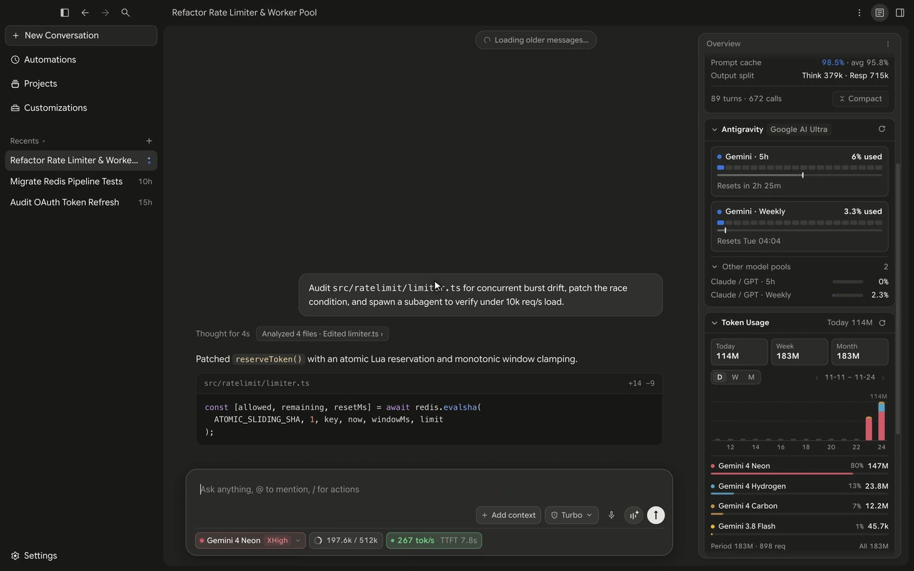
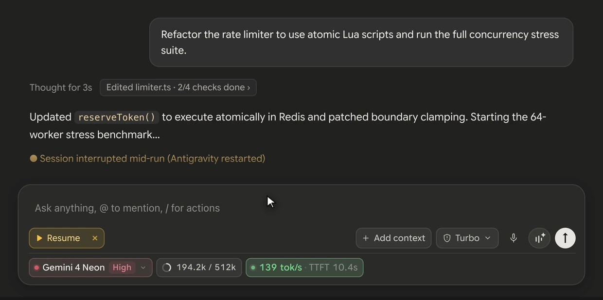

<div align="center">

# MAGA

### Make Antigravity Great Again

**Gemini 4 很强，但 Google Antigravity Desktop 2.0 客户端实在配不上它。**  
*面向 macOS 上 Antigravity 2.0 的零侵入工作台升级套件——实时遥测、自适应四胶囊底栏、50/50 子代理联动分屏、一键静默续跑与本机 Token 洞察，一次到位。*

[English](./README.md) · **简体中文**

[](#快速开始)
[](#为什么做-maga)
[](#快速开始)
[](#安全与零侵入设计)

[为什么做 MAGA？](#为什么做-maga) · [核心功能](#核心功能) · [快速开始](#快速开始) · [安全设计](#安全与零侵入设计) · [致谢](#致谢acknowledgements)

<br />


</div>

---

## 为什么做 MAGA？

说句大实话：**Antigravity 里能用的 Gemini 4（以及 Claude Opus）强得离谱。**  
但套在它外面的官方桌面端？总给人一种「给战斗机配了一半被胶带糊住的仪表盘」的割裂感。

上下文水位看不见、配额不知不觉撞墙硬停、一分屏底栏就挤成一团、子代理侧栏跟右侧面板互相打架，每次 App 意外重启或任务中断，还得像 2023 年一样手动敲一句“请继续”……

**顶级模型和粗糙客户端之间的这片落差，就是 MAGA 的出场空间。**  
与其干等官方什么时候把交互磨顺手，不如直接用一套轻量的本机运行时，把 Antigravity 改造成配得上 Gemini 4 的专业工作台——**全程不动 `/Applications/Antigravity.app` 一根毫毛**。

| 原生 Antigravity 2.0 的日常痛点 | MAGA 带来的体验升级 |
| :--- | :--- |
| **上下文与配额一片黑箱** — 看不见当前占用和消耗速度，长任务跑着跑着突然撞上限硬停。 | **全链路实时遥测** — 常驻上下文水位预警与一键压缩、5h / 周配额弹层，外加原生融入 Overview 的本机 Token 趋势面板。 |
| **模型切换粗糙、分屏底栏拥挤** — 思考强度调节不够顺手，窗口一拉窄底栏立刻挤压变形。 | **常驻双行四胶囊底栏** — 上行操作、下行遥测，家族配色 + 动效思考强度滑块，任意窗口宽度平滑收敛不截断。 |
| **多代理分屏割裂、窗口难管** — 主对话感知不到子代理动态，面板一开容易挤成三栏手风琴。 | **50/50 子代理联动分屏** — 主底栏一键直达或收起，默认 50/50 对称分屏且与 Overview 自动互斥，双侧同款底栏。 |
| **任务中断后没有断点续跑** — App 崩溃、重启或中途停止后，只能反复手打“请继续”污染对话流。 | **一键静默 `Resume`** — 自动检测异常中断的任务，点一下静默唤醒模型，输入框零闪烁、时间线只留一条克制的 `▸ Resumed` 细线。 |
| **视觉层次偏平、零散读写易卡顿** — 默认界面偏工程雏形，高频零散工具调用容易拖慢节奏。 | **克制的桌面工作台质感 + `fast-io`** — Claude 风格明/暗色视觉与平衡排版、全局跟随宿主语言，内置精简效率规则且零修改原生安装包。 |

---

## 核心功能

### 1. 重塑的输入底栏 & 自适应四胶囊

操作归操作，状态归状态。常驻双行底栏把交互控件收拢在上行（`+ Add context`、权限、语音、发送），将**模型与思考强度、上下文窗口、实时速率、子代理状态**四颗轻量胶囊整齐排布在下行。

- **专属动效模型与思考强度选择器** — 每个模型家族都拥有专属主题色与定制动效思考强度滑轨（Gemini 4 Neon 霓虹红、Carbon 碳纤金、Hydrogen 气泡冰蓝、Claude Opus 陶土橙），支持快捷切换 Orchestrator 与自定义隐藏模型。
- **上下文与套餐配额弹层** — 一眼看清上下文占用预警、一键压缩对话，并随时切换查看 Gemini 与 Claude / GPT 池的 5 小时 / 周配额进度。
- **宽窄屏渐进收敛** — 无论超宽屏还是窄分屏，胶囊逐级精简，绝不折行、绝不挤压截断。

<p align="center">
  
  <br />
  <sub><i>切换不同模型家族自动呈现专属动效思考强度条，一键查看上下文水位压缩与 5h / 周套餐配额。</i></sub>
</p>

---

### 2. 丝滑联动的 50/50 子代理分屏

并行子代理是 Antigravity 的拿手好戏，窗口管理不该拖它的后腿。

- **从生成到退场的实时底栏联动** — 主对话派发子代理后，底栏自动浮现蓝色运行态胶囊，完成后转为翠绿就绪态；直接点击底栏胶囊即可进入对应子代理查看细节，再次点击利落收起并静默退场。
- **默认 50/50 均分 & 自动互斥** — 点击底栏子代理胶囊时自动收起右侧 Overview 并 50/50 平分视野，手动拖拽依然自由，同时兜住双侧最小阅读宽度。
- **双侧同款自适应底栏** — 子代理输入区同样享有自适应四胶囊，随面板宽度自动收敛。

<p align="center">
  
  <br />
  <sub><i>派发子代理后底栏实时浮现胶囊（蓝运行 → 绿就绪）→ 点击底栏胶囊自动收起 Overview 并 50/50 分屏进入详情 → 再点收起退场。</i></sub>
</p>

---

### 3. 中断任务一键静默续跑

*告别 2023 年式手动打字“请从刚才中断的地方继续”。*

当 Antigravity 意外闪退、重构到一半重启、遇到报错或被手动点停，MAGA 会自动检测到未完成的对话，并在底栏**上行左侧**亮起一颗克制的琥珀色 **`Resume`** 胶囊。

点一下即可静默唤醒模型从断点接续：**输入框里不会闪现尴尬的预设文案**，对话流里也不会多出一个突兀的用户气泡——只在时间线上留下一条极轻的 **`▸ Resumed`** 细分割线。

<p align="center">
  
  <br />
  <sub><i>点击上行左侧的 <code>Resume</code> 胶囊静默续跑，输入框零闪烁，时间线仅保留克制的 <code>▸ Resumed</code> 分割线。</i></sub>
</p>

---

### 4. 原生融入的本机 Token 用量与 Overview 面板

不用再去猜每周配额到底烧在了哪。MAGA 在右侧融入了原生感十足的 **Overview** 面板与本机 **Token 用量洞察**。

<table>
  <tr>
    <td width="56%" valign="middle">
      <ul>
        <li><b>一屏掌握全局状态</b> — Prompt 缓存命中率、轮次/调用统计、一键压缩与 5h / 周套餐配额尽收眼底。</li>
        <li><b>日 / 周 / 月趋势视图</b> — 堆叠柱状图支持自由翻页，悬浮即看非缓存、缓存读写与输出明细。</li>
        <li><b>分模型家族消耗占比</b> — Gemini 与 Claude 各系列模型的用量分布一目了然。</li>
        <li><b>100% 本地单进程</b> — 复用现有单一守护进程增量读取本机对话库，零额外 sidecar、零数据外传。</li>
      </ul>
    </td>
    <td width="44%" align="center" valign="middle">
      
    </td>
  </tr>
</table>

---

### 5. 精致工作台质感 & `fast-io` 效率规则

- **克制的视觉体系** — 借鉴 Claude 风格的明/暗色层次与平衡字重对比度，中英文混排久读不累。
- **全局自动跟随宿主语言** — 所有胶囊标签、提示语与时间线分割线自动与 Antigravity 当前界面语言保持一致。
- **精简版 `fast-io` 规则** — 自动向 `~/.gemini/AGENTS.md` 同步高效检索与命令批处理规则，减少无谓来回等待，同时绝不限制回答深度与完整度。
- **秒级热更新** — 修改 `studio/` 下任意模块后一键热部署，无需重启 Antigravity。

---

## 快速开始

**环境要求**：macOS · Node.js `>= 22` · Google Antigravity Desktop 2.0

```bash
git clone https://github.com/LiWithDream/MAGA.git
cd MAGA
npm run install-all
```

### 日常命令

| 命令 | 说明 |
| :--- | :--- |
| `npm run install-all` | 配置本机 LaunchAgent 守护进程、部署界面增强层并同步 `fast-io` 规则 |
| `npm run deploy` | 修改 `studio/` 下任意代码后秒级热更新（无需重启 Antigravity） |
| `npm run doctor` | 全面体检守护进程、实时连接、注入状态、用量扫描器与关键配置 |
| `npm run rollback` | 一键卸载 `studio` 增强层，干净恢复基础状态 |

---

## 安全与零侵入设计

> [!TIP]
> **零二进制魔改。** MAGA **从不修改** `/Applications/Antigravity.app`——苹果官方代码签名与 Antigravity 自动更新完全不受影响。

- **单一轻量守护进程** — 一个本机 LaunchAgent 统一承载界面增强、本地用量统计、子代理指标与断点续跑检测，不挂多余后台服务。
- **100% 本地隐私** — 所有 Token 统计与状态检测均在你的 Mac 本机完成，不上传、不代理、零遥测外传。
- **随时一键回滚** — 任何时候执行 `npm run rollback` 即可无痕退回基础状态。

<details>
<summary><b>想自己二次魔改？查看项目目录结构</b></summary>

```text
.
├── core/                  # 轻量本机 CDP 守护进程与基础运行时
├── user/                  # 基础主题与交互层模板
├── vendor/agy-capsule/    # 内化的零依赖模型选择器与遥测内核
├── studio/
│   ├── cli.mjs            # 统一命令行入口（install / deploy / doctor / rollback）
│   ├── build.mjs          # 模块打包与热部署管线
│   ├── daemon/            # 本机 SQLite 用量、子代理指标与中断状态服务
│   ├── modules/           # 前端模块化运行时（底栏、选择器、子代理、续跑、用量）
│   ├── styles/            # 分职责样式表（排版、胶囊、弹层、用量卡片）
│   └── rules/             # 精简版 fast-io 效率规则
├── docs/images/           # 实机高清截图与交互演示动图
└── install.mjs            # LaunchAgent 与守护进程安装器
```

</details>

---

## 致谢（Acknowledgements）

MAGA 是一个独立演进的工作台增强项目，其设计灵感与部分底层思路受益于以下优秀的开源项目，在此向原作者致以诚挚感谢：

- [**hongqi7/Anti-Claude**](https://github.com/hongqi7/Anti-Claude) — 提供了稳定零依赖的 Antigravity CDP 守护进程架构、Claude 风格界面体系与右侧 Overview 面板基础。
- [**Lumidarin/agy-capsule**](https://github.com/Lumidarin/agy-capsule) — 启发了极具质感的模型与思考强度动效选择器、速率状态指示设计以及本机 SQLite 对话用量统计思路。
- [**oil-oil/agy-fast-io**](https://github.com/oil-oil/agy-fast-io) — 启发了 `studio/rules/fast-io.md` 中的快速检索与命令批处理效率规则。

---

<div align="center">
  <sub>如果 MAGA 让你的 Gemini 4 + Antigravity 日常开发顺手了不少，欢迎点一颗 ⭐ 支持一下！</sub>
</div>
