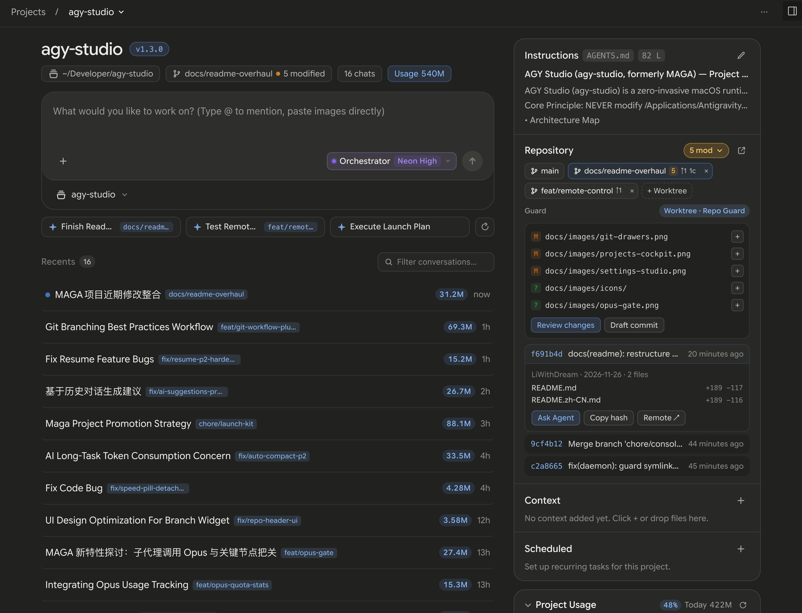
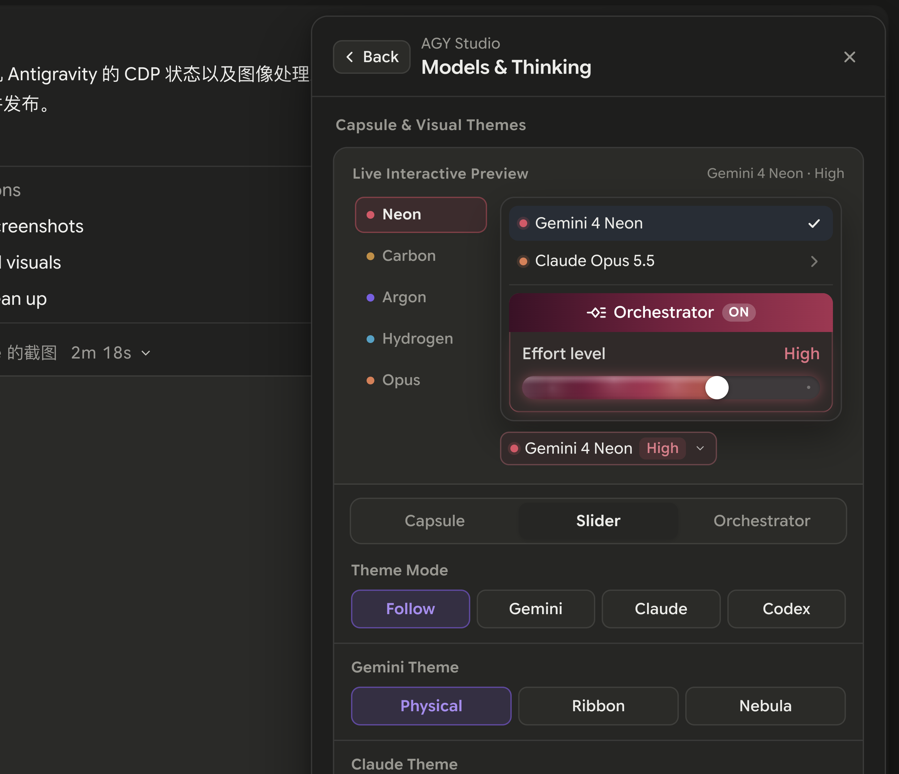

<div align="center">

# AGY Studio

**面向 macOS 上 Google Antigravity Desktop 2.0 的多项目与 Git Worktree 桌面工作台** *（原名 MAGA）*。  
把分项目 Token 用量、实时 Git 改动/提交抽屉、Gemini & Claude/GPT 双池配额、以及配额熔断 Claude Opus 把关整合进同一套单观测器前端，全程不修改 `/Applications/Antigravity.app`。

[English](./README.md) · **简体中文**

[](#局限与平台说明)
[](#核心能力)
[](#快速开始)
[](#架构与安全)
[](./LICENSE)

[快速开始](#快速开始) · [核心能力](#核心能力) · [兼容性矩阵](#兼容性矩阵) · [设置项参考](#设置项参考) · [故障排查](#故障排查) · [致谢](#致谢)

<br />


<sub><i>Projects 排序与详情工作台、Git 未提交清单与 <code>@file</code> 一键引用、分项目 Token 图表与三标签统一设置台。</i></sub>

</div>

---

## 为什么做这个工具

日常在 **Google Antigravity Desktop 2.0** 里同时跑多个仓库和子代理时，最影响效率的主要是三件事：

1. **多项目缺少集中工作台**：原生 Projects 页面看不到仓库未提交改动，对话一多也不清楚每场对话跑在哪个分支或 Worktree 上、烧了多少 Token。
2. **上下文与双池配额不透明**：5 小时滚动窗口、周配额、缓存命中率和按项目消耗都藏得很深，跑长任务很容易突然撞墙。
3. **堆砌独立监听会拖慢界面**：同时挂多个全树 `MutationObserver` 或大量 CSS `:has()` 选择器，会导致流式输出和模型菜单明显掉帧。

| 实测工程与安全指标 | 当前基线数据 |
| :--- | :--- |
| 根 DOM 观测器数量 (`window.__agyMagaKernel`) | **`1`** 个统一 `MutationObserver`（`data-maga-own` 自隔离） |
| 主线程刷帧耗时（Apple Silicon 本地 CDP 实测 `lastFlushMs`） | **`3.6 ms`**，高频遥测走叶节点原地更新（`MetricsBus`） |
| 全局 CSS `:has()` 选择器数量 | **`0`**（自动化测试硬守卫） |
| 自动化测试套件 (`npm test`) | **`175+`** 项全部通过，**`0`** 项跳过 |
| 对 `/Applications/Antigravity.app` 的改动 | **`0 bytes`**（苹果官方签名与自动更新完全不受影响） |
| 本机后台运行形态 | **`1`** 个 `LaunchAgent` 本地守护进程，数据全留本机 |

---

## 快速开始

**环境要求**：macOS（Apple Silicon 或 Intel）· Node.js `>= 22` · Google Antigravity Desktop 2.0

### 方式一：让 Antigravity / Claude Code 直接帮你装（推荐）

把下面这段话发给 Antigravity 或 Claude Code：

```text
帮我把 https://github.com/LiWithDream/agy-studio.git 克隆到 ~/Developer/agy-studio，先阅读 docs/INSTALL_AGENT.md，再执行 bash ./install.sh 并运行 node studio/cli.mjs doctor 验证状态。不要修改 /Applications/Antigravity.app，也不要删除现有对话和配置。
```

### 方式二：预编译 Release 压缩包（零 `npm install`）

前往 [Releases](https://github.com/LiWithDream/agy-studio/releases) 下载最新 `agy-studio-v*-macos.tar.gz`，解压后直接安装：

```bash
tar -xzf agy-studio-v*-macos.tar.gz && cd agy-studio-v*-macos
bash ./install.sh
```

Release 压缩包内已预编好 `user/custom.js` 与 `studio/prebuilt/studio-entry.js`，安装时会自动跳过 `npm install` 与 `esbuild`。

### 方式三：从源码克隆安装（自动安装 `esbuild`）

```bash
git clone https://github.com/LiWithDream/agy-studio.git ~/Developer/agy-studio
cd ~/Developer/agy-studio
bash ./install.sh
```

`install.sh` 会自动检查 Node.js `>= 22`，在源码缺少 `node_modules` 时自动跑一次 `npm install` 补齐 `esbuild`，再注册本地 `LaunchAgent`、热部署前端层并同步 `7` 行 `fast-io` 规则到 `~/.gemini/AGENTS.md`。任何时候执行 `bash ./uninstall.sh` 即可干净退回原状，不删聊天记录和个人配置。

---

## 核心能力

### 1. Projects 工作台、Git 实时抽屉与 Worktree 并行


- **项目排序墙与详情工作台**：支持按最近活跃、Token 用量、名称排序；进入项目后集中展示版本徽章、本地路径或远端仓库状态、`AGENTS.md` 指令渲染，以及带单场对话 Token 徽章的历史列表。
- **Git 脏文件与 Commit 详情抽屉**：展开未提交改动清单（带彩色 `+/-` 行数统计），点一下 `+` 直接把 `@file` 插入输入框，支持一键 `Review changes` / `Draft commit`；点开任意 Commit 可查看改动文件清单并跳转远端链接。
- **Git Worktree 界面、分级分支保护与 `wt` 工具**：在项目工作台与对话顶部项目栏（`#agy-conv-project-bar` + `#agy-wt-menu`）管理每场对话绑定的隔离 Worktree，在设置中按仓库配置集中式策略（`observe` / `protect-main` / `worktree-only`）且零配置污染，或使用 `npm run wt:new -- feat/name` 与全局 `wt.mjs` 快速建删分身。
- **分项目 Token 用量图表**：右下角原生嵌入日 / 周 / 月堆叠柱状图，悬浮即可核对非缓存输入、缓存读写、输出与全局占比（由单一守护进程以只读 `immutable=1` 扫描本机 SQLite，零额外盘扫）。
- **可选 Gemini 3.8 Flash 历史建议**：填自己的 Google AI Studio Key（`0600` 权限仅存本地）后，会结合近期 Git 提交历史与最近 5 条对话生成 3 个续跑建议按钮并支持冷启动交接。

<p align="center">
  
</p>

---

### 2. 双池配额透明、专属思考滑轨与 Opus 额度守门


- **双行四胶囊自适应底栏**：上行集中放操作按钮（`+ Add context`、权限、语音、发送），下行排布**模型与思考强度、上下文水位环、实时速率与 TTFT、子代理状态**；窄分屏与开启 Orchestrator 时按宽度逐级精简徽章，避免换行挤压。
- **模型家族思考滑轨与静态 Orchestrator 折叠**：支持 Gemini 4 Neon / Carbon / Argon / Hydrogen 与 Claude Opus 专属动效滑轨、常用模型隐藏过滤，以及把静态 `Orchestrator` 折叠进独立开关。
- **Gemini & Claude / GPT 双池配额 + Overview 看板**：点击上下文环即可看双池 5 小时 / 周配额余量并一键 `Compact`；右侧 Overview 长期展示缓存命中率、思维/输出占比和各模型系列消费趋势。
- **配额熔断版 Claude Opus Gate**：针对“Claude 额度总在不经意间烧光”的问题，仅在 `plan`（定方案）、`risk`（高风险改码）、`debug`（连续报错）、`stop`（收尾终审）节点通过底栏 `✦ 请 Opus 把关` 胶囊或受控 `/swarm` 调度 Opus，并在 5h/周配额低于阈值时自动降级或熔断。

---

### 3. 执行节奏控制、子代理分屏与统一设置台

<table>
  <tr>
    <td width="52%" valign="top">
      <ul>
        <li><b>三标签实时设置台</b> — 支持胶囊、滑条主题与 Orchestrator 样式实时预览，改动即时生效并持久化，支持 JSON 导入导出与一键复位。</li>
        <li><b>底栏子代理快捷分屏</b> — 派发子代理后底栏实时亮起胶囊（运行中蓝呼吸 → 完成后转绿），点一下自动收起右侧 Overview 与冗余列表展开对称分屏，再点收起。</li>
        <li><b>偶发中断一键静默 <code>Resume</code></b> — 检测到未完成对话时在上排左侧亮起温和胶囊，点一下直接从断点续跑，不在输入框闪现预设废话。</li>
        <li><b>缓存感知智能压缩 (`Auto-Compact`)</b> — 在长定时等待（<code>schedule</code>）或上下文达到阈值时，保护未发草稿并在 Prompt Cache 尚热时自动或半自动触发 <code>/compact</code>。</li>
        <li><b>7 行 <code>fast-io</code> 执行规则</b> — 将先 <code>grep</code> 后批读、免审白名单命令和阶段节点短汇报写入 <code>~/.gemini/AGENTS.md</code>，减少无效等待且不限制回答深度。</li>
      </ul>
    </td>
    <td width="48%" align="center" valign="middle">
      
    </td>
  </tr>
</table>

<details>
<summary><b>更多交互演示动图：模型滑轨与配额弹层、子代理分屏、静默 Resume</b></summary>
<br />
<p align="center">
  
  <br /><br />
  
  <br /><br />
  
</p>
</details>

---

## 兼容性矩阵

很多开发者本机已经装了其他反重力插件，以下是实测或架构级的共存关系说明：

| 插件 / 项目 | 共存关系 | 使用建议 |
| :--- | :--- | :--- |
| **`INK-Q/agy-fast`** | **可共存** | 对方专注 MCP 工具与搜索提效，不改写桌面前端 DOM，与 AGY Studio 互补。 |
| **`oil-oil/agy-fast-io`** | **规则二选一** | AGY Studio 已内置精简版 `7` 行 `fast-io` 规则；若想保留原版，安装时加 `--no-rules`（`bash ./install.sh --no-rules`）。 |
| **`Lumidarin/agy-capsule`** | **底栏重叠** | AGY Studio 已在 `vendor/agy-capsule/` 内置整合其 MIT 核心代码，不建议同时再挂一份独立 `agy-capsule`。 |
| **`WhiteBr1ck/agy-powertools`** | **CDP 界面重叠** | 两者都会接管 Antigravity 的前端注入层，请勿同时启用；切换前先执行 `bash ./uninstall.sh`。 |
| **第三方 ASAR 汉化补丁** | **未并发实测** | AGY Studio 设置页内置了轻量中文汉化开关且不动 `app.asar`；与直接解包修改 `app.asar` 的补丁混用暂未做交叉测试。 |

---

## 局限与平台说明

- **目前仅支持 macOS**：守护进程保活依赖 macOS `LaunchAgent` 与 `/usr/bin/open` CDP 自动重拉机制（`--remote-debugging-port=0`）。Windows 与 Linux 需单独适配进程托管与凭据隔离，已在 GitHub Issues 列为后续里程碑，欢迎前去投票排期。
- **提示词规则并非硬锁**：`~/.gemini/AGENTS.md` 中的 `7` 行规范能显著降低无效轮次，但大模型仍可能偶尔漏遵。
- **不做多账号代理与切号**：AGY Studio 定位在单工作台的多项目 / Worktree 调度、Git 联动与用量透明度，不修改请求网关或做多号轮询。

---

## 设置项参考

<details>
<summary><b>AGY Studio 设置面板完整可开关项清单（实时生效并自动持久化）</b></summary>

| 分类 | 设置项 | 默认值 | 说明 |
| :--- | :--- | :--- | :--- |
| **模型与思考** | 思考强度条与品牌色点 | `开` | 交互滑轨、色点识别、隐藏 `New` 等推广角标、Orchestrator 开关 |
| **模型与思考** | 滑条与 Orchestrator 主题 | `跟随模型` | 分家族动效皮肤（物理/丝带/星云、矩阵/诗行/星芒、Codex 流光等） |
| **模型与思考** | 按家族默认思考档位 | `Neon: High` | 切换模型家族时自动选中的初始档位 |
| **模型与思考** | 隐藏不常用模型 | `全部显示` | 从底部选择器隐藏用不到的模型项 |
| **模型与思考** | Opus 协同把关 (`Opus Gate`) | `半自动` | 模式（关闭/半自动/自动）、首选档位、5h/周配额熔断水位与 4 类触发节点 |
| **模型与思考** | Orchestrator 执行器模型 | `跟随系统默认` | 持久化覆盖开启 Orchestrator 后的轻量执行模型 |
| **对话与过程流** | 隐藏思考过程正文 | `开` | 收起冗长的英文 Thought 正文与展开箭头 |
| **对话与过程流** | 步骤流展示模式 | `紧凑折叠` | 统一同步宿主 `verboseConversationSteps` 与步骤展开状态 |
| **对话与过程流** | 中断恢复胶囊 (`Resume`) | `开` | 检测到任务意外中止时在底栏显示静默续跑按钮 |
| **对话与过程流** | 智能压缩上下文 (`Auto-Compact`) | `半自动` | 模式（关闭/半自动/自动）、触发阈值（`50%`）、长等待与高水位触发 |
| **对话与过程流** | 长代码块折叠与吸顶 | `开` | 超过 40 行自动折叠并吸顶语言栏与复制按钮 |
| **工作区与面板** | Overview 与项目用量图表 | `开` | 右侧 Overview 与项目详情页的日/周/月 Token 柱状图 |
| **工作区与面板** | 底部子代理胶囊与分屏 | `开` | 底栏实时状态胶囊与一键 50/50 联动分屏 |
| **工作区与面板** | 上下文圆环与双池配额弹层 | `开` | 实时上下文水位预警、5h/周限额与一键 `Compact` |
| **工作区与面板** | 侧栏统一「最近对话」 | `关` | 可选把原生项目分组收拢为按时间混排列表 |
| **工作区与面板** | Git 并行工作流策略 | `观察` | 按仓库配置 `observe` / `protect-main` / `worktree-only` 与强推拦截 |
| **工作区与面板** | AI 历史对话建议 | `关`（可选 Key） | 使用 Gemini 3.8 Flash 结合 Git 历史与最近 5 条对话推荐下一步起点 |
| **语言与外观** | 中文界面汉化与字高校准 | `关` / `95%` | 内置简体中文开关与苹果苹方视觉字高（`94.5%` / `95%` / `100%`） |
| **语言与外观** | 交互动效强度 | `完整` | `完整` / `精简` / `关闭` |

</details>

### 日常命令

| 命令 | 作用 |
| :--- | :--- |
| `bash ./install.sh` | 一键安装（源码缺依赖时自动补齐，Release 包跳过 `npm install`）、注册守护进程并同步规则 |
| `npm run deploy` | 在干净 `main` 上修改代码后秒级热更新至运行中的 Antigravity（无需重启客户端） |
| `node studio/cli.mjs doctor` | 全面检查守护进程、CDP 连接、注入标记、用量扫描与 `proxyDiagnostics` |
| `npm run wt:new -- feat/slug` | 创建隔离开发用 Git Worktree 并自动软链 `node_modules` |
| `npm run release:pack` | 生成零 `npm install` 的 macOS Release 压缩包及 SHA-256 校验文件到 `dist/` |
| `bash ./uninstall.sh` | 干净卸载增强层、守护进程与注入规则，保留聊天记录与个人设置 |

---

## 架构与安全

<details>
<summary><b>目录结构与自动化守卫</b></summary>

```text
.
├── core/                  # 本地 CDP 守护进程与子模块（挂载、冷启引导、SQLite、项目扫描、worktrees）
├── user/src/              # 21 个模块化 ESM 前端源码（全部 <2,000 行，编入 user/custom.js）
├── vendor/agy-capsule/    # 内化整合的 MIT 模型/滑轨核心、动效主题与 SQLite 解析
├── studio/
│   ├── core/              # MagaKernel（单根观测器）、DomFlags、MetricsBus、状态快照
│   ├── shared/            # 单一数据源偏好设置 Schema 与清洗校验
│   ├── daemon/            # 用量聚合、中断检测、AI 历史建议、插件同步与各服务守护逻辑
│   ├── modules/           # 底栏胶囊、三标签设置台、智能压缩、子代理分屏
│   ├── plugin/            # 托管原生插件（maga-opus-gate、maga-auto-compact、maga-git-workflow）
│   ├── styles/            # 作用域样式表（全仓 0 条 :has() 选择器）
│   ├── cli.mjs            # 统一 CLI（install / deploy / sync-rules / doctor / rollback）
│   └── pack-release.mjs   # 零依赖 Release 压缩包打包器
├── test/                  # 自动化测试套件（DOM、CSS 守卫、Opus Gate、Worktree、安装链路）
├── install.sh             # 一键安装脚本（支持 --dry-run、预编包与源码模式）
└── uninstall.sh           # 一键无痕回滚卸载脚本（支持 --dry-run）
```

</details>

---

## 故障排查

### 遇到 `Error Loading Models` / `loadCodeAssist: EOF`

该报错来自 Antigravity 原生后端 `language_server` 访问 `daily-cloudcode-pa.googleapis.com` 时代理或 TLS 断开，与前端注入无关：

1. 在代理客户端（Clash / Mihomo / Surge / V2Ray）开启 **TUN 模式**或**系统代理**，确认 `*.googleapis.com` 走稳定节点。
2. **启动参数自动透传**：如果在终端带了代理或自定义 CA 环境变量（`HTTP_PROXY`、`HTTPS_PROXY`、`ALL_PROXY`、`NO_PROXY`、`SSL_CERT_FILE`、`NODE_EXTRA_CA_CERTS`）或 `--proxy-*` 启动参数，AGY Studio 在 macOS 自动补充 `--remote-debugging-port=0` 重拉时会完整透传；可运行 `node studio/cli.mjs doctor` 查看 `proxyDiagnostics`。
3. 如希望手动管理 `--remote-debugging-port=0` 而不由守护进程重拉，启动守护进程时加上 `ANTI_CLAUDE_NO_CDP_BOOTSTRAP=1`。

---

## 致谢

AGY Studio（原名 MAGA）基于以下开源项目构建并集成其 MIT 核心模块：

- [**hongqi7/Anti-Claude**](https://github.com/hongqi7/Anti-Claude) — 提供了不修改 `.app` 二进制的 Antigravity 本地 CDP 守护进程底座（`core/`）、Claude 风格明暗视觉体系、Overview 面板框架及上下文/配额弹层基础。
- [**Lumidarin/agy-capsule**](https://github.com/Lumidarin/agy-capsule)（MIT 协议）— 直接内置整合于 `vendor/agy-capsule/`，提供了模型与思考强度选择器、多模型动效主题、实时速率遥测与本地 SQLite 用量解析逻辑。
- [**LLYSH-HANNARI/antigravity-Codex-Claude-effort-slider**](https://github.com/LLYSH-HANNARI/antigravity-Codex-Claude-effort-slider)（MIT 协议）— 随 `agy-capsule` 引入，贡献了分模型家族的专属滑轨动效设计及从宿主 React 树直写模型与思考档位的思路。
- [**oil-oil/agy-fast-io**](https://github.com/oil-oil/agy-fast-io) — 贡献了先 `grep` 定位后批读、优先用免审白名单只读命令的核心提效思路，精炼整合为 `studio/rules/fast-io.md`。

---

<div align="center">
  <sub>MIT License · 如果 AGY Studio 帮你在 macOS 上把 Antigravity 2.0 用得更顺手，欢迎点一颗 ⭐，也欢迎到 Issues 给 Windows 支持投票。</sub>
</div>
