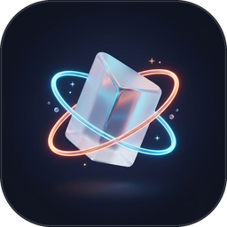
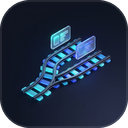
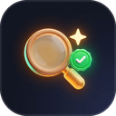
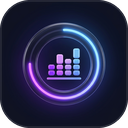
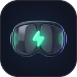
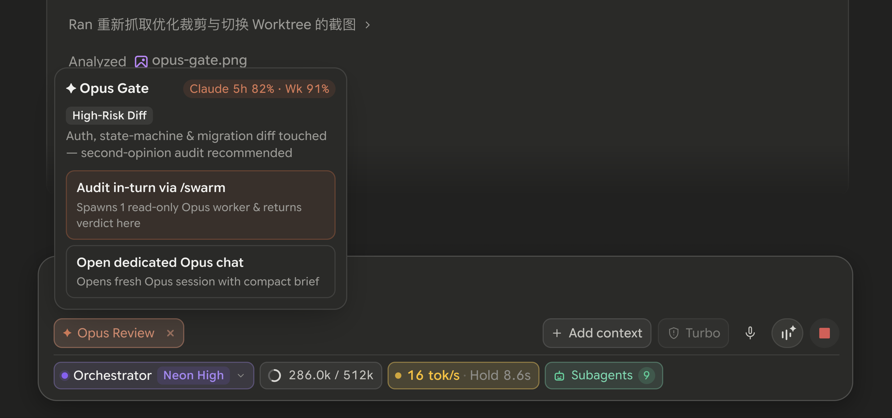
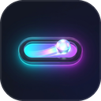
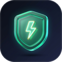

<div align="center">



# AGY Studio

<h3>把 Antigravity 用成一支工程团队。</h3>

[English](./README.md) · **简体中文**

[](https://github.com/LiWithDream/agy-studio/stargazers)
[](https://github.com/LiWithDream/agy-studio/releases)
[](#局限与平台支持)
[](#核心能力)
[](#craft-ergonomics)
[](./LICENSE)

10 秒安装：复制一段话发给 Antigravity 即可 → **[快速开始](#快速开始)**

<table>
  <tr>
    <td align="center" width="216" valign="top">
      <a href="#parallel-engineering"></a><br />
      <a href="#parallel-engineering"><b>多项目并行开发</b></a><br />
      <sub>独立 Worktree · 改动随手引用</sub>
    </td>
    <td align="center" width="216" valign="top">
      <a href="#cross-model-review"></a><br />
      <a href="#cross-model-review"><b>Opus 交叉复核</b></a><br />
      <sub>关键节点一键或自动把关</sub>
    </td>
    <td align="center" width="216" valign="top">
      <a href="#tokens-and-context"></a><br />
      <a href="#tokens-and-context"><b>配额与上下文</b></a><br />
      <sub>双池余量 · 智能防上下文退化</sub>
    </td>
    <td align="center" width="216" valign="top">
      <a href="#long-runs"></a><br />
      <a href="#long-runs"><b>长任务免看护</b></a><br />
      <sub>子代理分屏 · 中断静默续跑</sub>
    </td>
  </tr>
</table>


<sub><i>项目墙切换 → 未提交改动与 <code>@file</code> 一键引用 → 分项目 Token 统计 → 实时设置预览，一屏完成。</i></sub>

</div>

---

## 原生 Antigravity vs. AGY Studio

原生 Antigravity Desktop 2.0 擅长的是**单对话跑单个代理**；一旦你需要同时维护多个仓库、并行开多条开发线、跑超长上下文并盯紧双池额度，**AGY Studio** 会把它升级成一整套工程工作台：

| 日常开发场景 | 原生 Antigravity | 使用 AGY Studio 后 |
| :--- | :--- | :--- |
| **多仓库、多分支并行开发** | 多场对话共用同一工作区，容易改串分支，也看不清哪个仓库有未提交改动 | 每场对话独享隔离 Git Worktree、按仓库分级防误操作，未提交改动与 `@file` 引用随手可得 |
| **方案定型、高危改码与疑难排错** | 手动复制上下文切模型复核，或者硬着头皮直接合并 | 关键节点一键或自动请 Claude Opus 独立复核（`plan` / `risk` / `debug` / `stop`） |
| **掌握项目花费与 5h / 周配额** | 分项目 Token 消耗、缓存命中率和双池余量分散且不直观 | Gemini 与 Claude/GPT 双池余量、缓存命中率、分项目日/周/月柱状图一眼看全 |
| **长对话防止上下文退化** | 等模型变笨了才手动敲 `/compact`，常常错过缓存热窗 | 缓存感知智能压缩（`Auto-Compact`），到阈值或长等待前自动瘦身，且不覆盖未发草稿 |
| **跑长任务与多子代理免盯屏** | 子代理藏在侧栏里；流式中断后要手动补发提示词续跑 | 底栏一键 50/50 子代理分屏、偶发中断一键静默 `Resume`、折叠噪音并减少无效轮次 |
| **模型操控与中文阅读体验** | 底栏拥挤、缺少思考档位预设、原生仅英文界面 | 分家族思考强度滑轨、隐藏不常用模型、实时三标签设置台，以及内置简体中文与苹方字高校准 |
| **离开电脑时远程盯进度与审批** | 只能守在桌面窗口前查看与授权 | 加密移动 PWA 与原生 Android 客户端（走 Cloudflare Access / Tailscale），支持审批、发图、对话、`Opus Gate` 与自托管 OTA 更新 |

---

## 核心能力

<a id="parallel-engineering"></a>

###  &nbsp;1. 多项目并行开发，互不踩踏

**同时推进多个仓库与多条需求线，分支隔离、改动透明、上下文秒级接续。**


- **对话级 Worktree 隔离与分级保护**：在项目工作台或对话顶栏直接为当前任务新建/切换隔离 Worktree；在设置中按仓库配置保护策略（`observe` / `protect-main` / `worktree-only`）与防强推拦截，集中托管、不往项目仓库塞任何配置文件。
- **把 Git 改动直接变成提问上下文**：无需切终端即可查看仓库未提交改动与近期 Commit 差异；点一下 `+` 把 `@file` 塞进输入框，或一键发起 `Review changes`、`Draft commit`。
- **多项目全局视图与续跑建议**：按最近活跃、Token 花费或名称排列所有项目，集中查看 `AGENTS.md` 与单场对话耗时花费；还可选填自己的 Google AI Studio Key，基于近期 Git 提交与最近 5 条对话自动生成 3 个冷启动续跑建议。

<details>
<summary><b>查看更多界面与机制说明</b></summary>
<br />
<p align="center">
  
</p>
<ul>
  <li><b>命令行同步支持</b>：内置通用 <code>wt</code> 工具（<code>wt.mjs</code>）及可选本地 Git 钩子，让终端操作与 Agent 对话遵守同一套分支保护规范。</li>
  <li><b>AI 历史建议默认关闭</b>：仅在你主动填写个人 Google AI Studio Key（仅存本机）时启用 Gemini 3.8 Flash 生成建议，不上传多余数据。</li>
</ul>
</details>

---

<a id="cross-model-review"></a>

###  &nbsp;2. 关键节点跨模型把关（Opus Review Gate）

**让高速模型全速写代码，在最容易踩坑的 4 个节点请 Claude Opus 独立复核。**



| 触发节点 | 适用时机 | Opus 重点把关什么 |
| :--- | :--- | :--- |
| **`plan`** | 跨模块方案定型、复杂重构开工前 | 架构耦合、边界漏项、前置假设是否站得住 |
| **`risk`** | 改动涉及权限、并发锁、状态机、数据迁移 | 竞态条件、安全回退与隐蔽不变量破坏 |
| **`debug`** | 连续多次排查仍未定位根因 | 跳出原模型思维定势，做独立根因诊断 |
| **`stop`** | 复杂多步改动收尾、准备合并前 | 上线前最终 Diff 审计，拦截遗留回归 |

- **半自动与全自动随心切**：默认**半自动（Semi-auto）**，命中关键节点时在底栏亮起一键把关按钮，点一下才调用；切到**自动（Auto）**则通过 `/swarm` 自动派发只读 Opus 复核。
- **自带额度安全垫**：后台实时盯着 Claude 5 小时与周配额，余量偏低时自动降档或暂停触发，不用担心一次复核悄悄把订阅额度烧空。

---

<a id="tokens-and-context"></a>

###  &nbsp;3. Token、配额与上下文，尽在掌握

**告别“跑着跑着突然限流或失忆”，把每一分额度与上下文窗口用明白。**


- **双池配额与缓存命中一目了然**：在右侧 Overview 或上下文环弹层中同屏查看 Gemini 与 Claude/GPT 的 5 小时 / 周配额余量、Prompt Cache 命中率以及思考/回复输出占比，支持一键 `Compact`。
- **分项目、分对话花费拆解**：内置日 / 周 / 月堆叠柱状图，悬浮即可核对非缓存输入、缓存读写、输出 Token 与全局占比，一眼看清是哪个仓库、哪场对话在烧额度。
- **缓存感知智能压缩（`Auto-Compact`）**：当上下文达到设定水位或即将进入长定时等待时，趁 Prompt Cache 尚热自动或半自动执行 `/compact`，同时保护输入框中未发送的草稿。

<details>
<summary><b>交互演示：模型思考强度滑轨与双池配额弹层</b></summary>
<br />
<p align="center">
  
</p>
</details>

---

<a id="long-runs"></a>

###  &nbsp;4. 长任务免看护，高信号交付

**派发复杂多步任务后安心保持心流，不被子代理抽屉、偶发断流和冗长过程打断。**

<table>
  <tr>
    <td width="50%" align="center" valign="top">
      
      <br /><sub><i>底栏一键展开 / 收起 50/50 子代理分屏</i></sub>
    </td>
    <td width="50%" align="center" valign="top">
      
      <br /><sub><i>流式意外中断后一键静默续跑</i></sub>
    </td>
  </tr>
</table>

- **底栏子代理一键 50/50 分屏**：派发子代理后底栏亮起实时胶囊（运行中呼吸提示 → 完成后转绿），点一下自动收起冗余侧栏进入对称分屏，再点一下收起。
- **偶发中断一键静默 `Resume`**：检测到对话中途意外断流时在底栏浮现轻巧的 `Resume` 按钮，点一下直接从断点续跑，不在输入框闪现多余的模板废话。
- **过滤噪音、减少空转轮次**：自动折叠冗长的英文思考正文与超过 40 行的代码块（带吸顶复制栏），实时显示输出速率与 TTFT；同时可选同步精简版 `fast-io` 执行规则，减少重复读文件造成的无效轮次，且不压缩最终回答深度。

---

<a id="remote-companion"></a>

### 5. 手机与网页远程操控（Remote Control & Android 客户端）

**离开桌面也能实时看流式进度、点工具审批与继续追问——零公网端口暴露。**

- **7 文件零依赖回环网关与边界认证**：网关严格仅监听 `127.0.0.1:18791`，通过 Cloudflare Access（JWKS RS256）、Tailscale Serve 或本机回环接入；支持一次性配对码与桌面端本地 SVG 二维码扫码配对，基于 ECDSA P-256 设备握手与角色权限（`observe` / `steer` / `admin`）随时升降级或吊销设备。
- **完整控制台体验（桌面三栏 + 移动端）**：实时查看过程流、双池配额与分项目视图，支持交互式 `askQuestion` 单选/多选卡片、切换模型与思考档位、粘贴或相机传图、触发 `/compact` / `Resume` / `Opus Gate` 复核，并对 `TURBO` 模式强制二次确认防误触。
- **原生 Android 客户端与自托管 OTA（`remote/android/`）**：沉浸式全面屏壳体、原生通知与震动反馈、系统分享直接传图、应用内 OAuth 登录、断网/切网/WebView 崩进程自愈、可选前台保活监听服务（`KeepAliveService`），以及走同源 Cloudflare Access 校验的应用内静默查更与一键 OTA 安装。

---

## 快速开始

**环境要求**：macOS（Apple Silicon 或 Intel）或 Windows 10/11（x64 / ARM64）· Node.js `>= 22` · Google Antigravity Desktop 2.0

### 推荐方式：直接让 Antigravity 或 Claude Code 帮你装

把下面这段话直接发给 Antigravity 或 Claude Code：

```text
先检查 Node.js >= 22（`node -v`）。macOS 若 ~/Developer/agy-studio/.git 已存在则执行 `git -C ~/Developer/agy-studio pull --ff-only --autostash`，否则克隆 https://github.com/LiWithDream/agy-studio.git 到 ~/Developer/agy-studio 并运行 `bash ./install.sh`；Windows 10/11（PowerShell）若 %LOCALAPPDATA%\agy-studio\.git 已存在则执行 `git -C "$env:LOCALAPPDATA\agy-studio" pull --ff-only --autostash`，否则克隆到该目录并运行 `powershell -ExecutionPolicy Bypass -File .\install.ps1`。先阅读 docs/INSTALL_AGENT.md，最后运行 `node studio/cli.mjs doctor` 验证。不要修改客户端二进制，不要删除现有对话和配置，也不要在当前 Antigravity 对话内部退出或重启客户端（若 doctor 返回 pending_restart，请提示我手动重启一次 Antigravity）。
```

> **安全无侵入**：不修改 macOS `/Applications/Antigravity.app` 或 Windows `Antigravity.exe` / `app.asar`，所有数据留在本地，随时执行 `bash ./uninstall.sh`（macOS）或 `.\uninstall.ps1`（Windows）即可无痕还原 → [了解安全与性能设计](#safe-fast)。*（提示：Windows 通过 `irm ... | iex` 执行时无法读取 `$PWD`，会自动克隆至 `%LOCALAPPDATA%\agy-studio`；PowerShell 5.1 需附加 `-ExecutionPolicy Bypass`。）*

<details>
<summary><b>其他安装方式（预编译 Release 压缩包 / 源码安装 / 诊断与卸载）</b></summary>

#### 方式二：预编译 Release 压缩包（零 `npm install`）

前往 [Releases](https://github.com/LiWithDream/agy-studio/releases) 下载对应平台的压缩包（macOS：`agy-studio-v*-macos.tar.gz`，Windows：`agy-studio-v*-windows.zip`），解压后直接安装：

```bash
# macOS
tar -xzf agy-studio-v*-macos.tar.gz && cd agy-studio-v*-macos
bash ./install.sh
```

```powershell
# Windows (PowerShell)
Expand-Archive .\agy-studio-v*-windows.zip -DestinationPath .
cd .\agy-studio-v*-windows
powershell -ExecutionPolicy Bypass -File .\install.ps1
```

#### 方式三：从源码克隆安装

```bash
# macOS
git clone https://github.com/LiWithDream/agy-studio.git ~/Developer/agy-studio
cd ~/Developer/agy-studio
bash ./install.sh
```

```powershell
# Windows (PowerShell)
git clone https://github.com/LiWithDream/agy-studio.git "$env:LOCALAPPDATA\agy-studio"
cd "$env:LOCALAPPDATA\agy-studio"
powershell -ExecutionPolicy Bypass -File .\install.ps1
```

若不想同步 `fast-io` 执行规则到 `~/.gemini/AGENTS.md`，安装时附加 `--no-rules`（Windows 为 `-NoRules`）即可。

#### 日常运维命令

| 命令 | 作用 |
| :--- | :--- |
| `node studio/cli.mjs doctor` | 一键检查守护进程、CDP 挂载、插件状态、用量扫描与代理诊断 |
| `bash ./uninstall.sh` / `.\uninstall.ps1` | 干净卸载增强层、守护进程与同步规则，保留全部聊天记录与个人设置 |

</details>

---

<a id="craft-ergonomics"></a>

##  &nbsp;细节打磨与高度可定制

每天高强度泡在 Antigravity 里，顺手的细节同样重要——所有模块均可按需开关：

<table>
  <tr>
    <td width="52%" valign="top">
      <ul>
        <li><b>三标签实时设置台</b> — 每一项功能独立开关，滑轨与动效主题改动即时预览、自动持久化，支持 JSON 导入导出与一键复位。</li>
        <li><b>双行自适应底栏与思考滑轨</b> — 操作按钮与实时遥测上下分行，窄分屏依然利落；内置分模型家族思考强度滑轨、隐藏不常用模型，以及持久化 Orchestrator 执行器模型。</li>
        <li><b>内置简体中文界面与苹方字高校准</b> — 在设置里一键开启中文界面与 <code>94.5% / 95% / 100%</code> 视觉字高校准，免拆包汉化。</li>
        <li><b>灵活的侧栏视图</b> — 可选把原生项目分组收拢为按时间混排的统一「最近对话」。</li>
      </ul>
    </td>
    <td width="48%" align="center" valign="middle">
      
    </td>
  </tr>
</table>

---

<a id="safe-fast"></a>

##  &nbsp;安全与流畅设计

**会不会破坏客户端更新、拖慢流式输出，或者上传我的数据？** 不会。

- **原生应用零修改**：完全通过单个本地后台守护进程（macOS `LaunchAgent` 或 Windows 无黑框计划任务 / 启动项兜底）与 Chrome DevTools Protocol（CDP）运行时挂载，对 `/Applications/Antigravity.app` 与 Windows `Antigravity.exe` / `app.asar` 改动为 `0 bytes`，官方代码签名与自动更新不受任何影响。
- **100% 本地运行、一键可逆**：Token 用量通过只读模式（`immutable=1`）解析 Antigravity 本地 SQLite，无任何远程埋点或云端中转（AI 历史建议仅在你主动填入个人 Key 时直连 Google AI Studio）；随时执行 `bash ./uninstall.sh` 或 `.\uninstall.ps1` 即可无痕退回原生状态。
- **专为零掉帧架构**：所有模块共用 1 个带自隔离的根级观测器，高频速率走叶节点原地刷新，并由自动化测试守卫全仓零 `:has()` 选择器。

| 实测工程与安全指标 | 当前基线 |
| :--- | :--- |
| 对 Antigravity 客户端二进制的改动 | **`0 bytes`**（官方签名与自动更新完好） |
| 根 DOM 观测器数量（`MagaKernel`） | **`1`** 个统一 `MutationObserver`（`data-maga-own` 自隔离） |
| 主线程刷帧耗时（Apple Silicon 本地 CDP 实测） | **`1.5–3.6 ms`**，高频遥测走叶节点原地更新（`MetricsBus`） |
| 全局 CSS `:has()` 选择器数量 | **`0`**（自动化测试硬守卫） |
| 自动化回归与不变量测试（`npm test`） | **`225+`** 项全部通过，**`0`** 项跳过 |
| 后台进程占用 | **`1`** 个本地 `LaunchAgent`（macOS）/ 计划任务（Windows） |

---

## 兼容性

如果你本机已经装了其他 Antigravity 插件，以下是实测或架构级的共存说明：

| 插件 / 项目 | 共存关系 | 使用建议 |
| :--- | :--- | :--- |
| **`INK-Q/agy-fast`** | **可共存** | 对方专注 MCP 工具与搜索提效，不改写前端 DOM，与 AGY Studio 互补。 |
| **`oil-oil/agy-fast-io`** | **规则二选一** | AGY Studio 已内置精简版 `fast-io` 规则；若想保留原版，安装时加 `bash ./install.sh --no-rules`。 |
| **`Lumidarin/agy-capsule`** | **底栏重叠** | AGY Studio 已在 `vendor/agy-capsule/` 内置整合其 MIT 核心代码，请勿同时再挂一份独立版。 |
| **`WhiteBr1ck/agy-powertools`** | **前端层重叠** | 两者都会接管 Antigravity 的 CDP 前端层，请勿同时启用；切换前先执行 `bash ./uninstall.sh`。 |
| **第三方 ASAR 汉化补丁** | **未并发实测** | AGY Studio 已自带免拆包中文界面开关，与直接解包修改 `app.asar` 的补丁混用暂未做交叉测试。 |

---

## 局限与平台支持

- **已支持 macOS 与 Windows 10/11；Linux 规划中**：macOS 基于 `LaunchAgent` + `/usr/bin/open`（支持完整终端代理环境变量透传）；Windows 基于用户级无黑框计划任务（`AGYStudioDaemon`，受限策略下自动回退 Startup `.vbs`）、开始菜单快捷方式 `Antigravity (AGY Studio)` 与温和 `WM_CLOSE` CDP 冷启动引导（注：Windows 无法读取已运行进程的环境变量，如遇网络报错建议在代理客户端开启系统代理或 TUN 模式）。Linux 支持已在 GitHub Issues 立项排期。
- **提示词规则并非硬锁**：`~/.gemini/AGENTS.md` 中的 `fast-io` 规则能明显减少无效轮次，但大模型仍可能偶尔漏遵。
- **不做多账号代理与切号**：AGY Studio 聚焦单工作台的并行工程、跨模型把关与用量掌控，不修改请求网关或做多号轮询。

---

## 设置项参考

<details>
<summary><b>AGY Studio 设置面板完整可配置项（实时生效并自动持久化）</b></summary>

| 分类 | 设置项 | 默认值 | 说明 |
| :--- | :--- | :--- | :--- |
| **模型与思考** | 思考强度条与品牌色点 | `开` | 交互滑轨、品牌色点、隐藏 `New` 推广角标、Orchestrator 开关 |
| **模型与思考** | 滑条与 Orchestrator 主题 | `跟随模型` | 分家族动效皮肤（物理/丝带/星云、矩阵/诗行/星芒、Codex 流光） |
| **模型与思考** | 按家族默认思考档位 | `Neon: High` | 切换模型家族时自动选中的初始档位 |
| **模型与思考** | 隐藏不常用模型 | `全部显示` | 从底部选择器隐藏用不到的模型 |
| **模型与思考** | Opus 复核把关（`Opus Gate`） | `半自动` | 模式（关闭/半自动/自动）、首选档位、5h/周配额保护水位与 4 类节点开关 |
| **模型与思考** | Orchestrator 执行器模型 | `跟随系统默认` | 持久化覆盖开启 Orchestrator 后的轻量执行模型 |
| **对话与过程流** | 隐藏思考过程正文 | `开` | 收起冗长的英文 Thought 正文与展开箭头 |
| **对话与过程流** | 步骤流展示模式 | `紧凑折叠` | 统一同步宿主步骤详细程度与展开状态 |
| **对话与过程流** | 中断恢复胶囊（`Resume`） | `开` | 检测到流式意外中止时在底栏显示静默续跑按钮 |
| **对话与过程流** | 智能压缩上下文（`Auto-Compact`） | `半自动` | 模式（关闭/半自动/自动）、触发阈值（`50%`）、长等待与高水位触发 |
| **对话与过程流** | 长代码块折叠与吸顶 | `开` | 超过 40 行自动折叠并吸顶语言栏与复制按钮 |
| **工作区与面板** | Overview 与项目用量图表 | `开` | 右侧 Overview 与项目详情页的日/周/月 Token 柱状图 |
| **工作区与面板** | 底部子代理胶囊与分屏 | `开` | 底栏实时状态胶囊与一键 50/50 联动分屏 |
| **工作区与面板** | 上下文圆环与双池配额弹层 | `开` | 实时上下文水位预警、5h/周限额与一键 `Compact` |
| **工作区与面板** | 侧栏统一「最近对话」 | `关` | 可选把原生项目分组收拢为按时间混排列表 |
| **工作区与面板** | Git 并行工作流策略 | `观察` | 按仓库配置 `observe` / `protect-main` / `worktree-only` 与强推拦截 |
| **工作区与面板** | AI 历史对话建议 | `关`（可选 Key） | 使用 Gemini 3.8 Flash 结合 Git 历史与最近 5 条对话推荐下一步起点 |
| **远程控制** | 网关开关、外网通道与配对 | `关` | 零依赖 `127.0.0.1:18791` 网关、Cloudflare Access / Tailscale / 本机通道、本地 SVG 扫码配对与设备角色/吊销 |
| **语言与外观** | 中文界面汉化与字高校准 | `关` / `95%` | 内置简体中文开关与苹果苹方视觉字高（`94.5%` / `95%` / `100%`） |
| **语言与外观** | 交互动效强度 | `完整` | `完整` / `精简` / `关闭` |

</details>

---

## 故障排查

### 遇到 `Error Loading Models` / `loadCodeAssist: EOF`

该报错来自 Antigravity 原生后端 `language_server` 访问 `daily-cloudcode-pa.googleapis.com` 时代理或 TLS 断开，与 AGY Studio 前端层无关：

1. 在代理客户端（Clash / Mihomo / Surge / V2Ray）开启 **TUN 模式**或**系统代理**，确认 `*.googleapis.com` 走稳定节点。
2. **代理环境自动透传**：若在终端带了代理或自定义 CA 环境变量（`HTTP_PROXY`、`HTTPS_PROXY`、`ALL_PROXY`、`NO_PROXY`、`SSL_CERT_FILE`、`NODE_EXTRA_CA_CERTS`）或 `--proxy-*` 启动参数，AGY Studio 在 macOS 自动补充 `--remote-debugging-port=0` 重拉时会完整透传；可运行 `node studio/cli.mjs doctor` 查看 `proxyDiagnostics`。
3. 如希望手动管理 `--remote-debugging-port=0` 而不由守护进程重拉，启动守护进程时加上 `ANTI_CLAUDE_NO_CDP_BOOTSTRAP=1`。

---

## 架构与贡献指南

<details>
<summary><b>目录结构与开发者常用命令</b></summary>

```text
.
├── core/                  # 本地 CDP 守护进程与子模块（挂载、冷启引导、SQLite、项目扫描、worktrees）
├── user/src/              # 22 个模块化 ESM 前端源码（全部 <2,000 行，编入 user/custom.js）
├── remote/                # 远程控制零依赖回环网关（7 文件）、模块化 PWA 与原生 Android 客户端
├── vendor/agy-capsule/    # 内化整合的 MIT 模型/滑轨核心、动效主题与 SQLite 解析
├── studio/
│   ├── core/              # MagaKernel（单根观测器）、DomFlags、MetricsBus、状态快照
│   ├── shared/            # 单一数据源偏好设置 Schema 与清洗校验
│   ├── daemon/            # 用量聚合、中断检测、AI 历史建议、插件同步与各服务守护逻辑
│   ├── modules/           # 底栏胶囊、设置台（含远程控制与本地二维码）、智能压缩、子代理分屏
│   ├── plugin/            # 托管原生插件（maga-opus-gate、maga-auto-compact、maga-git-workflow）
│   ├── styles/            # 作用域样式表（全仓 0 条 :has() 选择器）
│   ├── cli.mjs            # 统一 CLI（install / deploy / sync-rules / doctor / rollback / remote）
│   └── pack-release.mjs   # 零依赖 Release 压缩包打包器
├── test/                  # 自动化测试套件（225+ 项回归与架构守卫）
├── install.sh             # 一键 macOS 安装脚本（支持 --dry-run、预编包与源码模式）
├── uninstall.sh           # 一键 macOS 无痕回滚卸载脚本（支持 --dry-run）
├── install.ps1            # 一键 Windows PowerShell 安装脚本（支持 -DryRun / -NoRules / -NoShortcut）
└── uninstall.ps1          # 一键 Windows 无痕回滚卸载脚本（支持 -DryRun / -Purge）
```

| 开发者命令 | 作用 |
| :--- | :--- |
| `npm run wt:new -- feat/slug` | 创建隔离开发用 Git Worktree 并自动软链 / Junction `node_modules` |
| `npm test` | 编译 `user/custom.js` 并运行全部 225+ 项回归与不变量测试 |
| `npm run deploy` | 在干净 `main` 上秒级热更新至运行中的 Antigravity（无需重启客户端） |
| `npm run release:pack:all` | 生成零 `npm install` 的 macOS `.tar.gz` 与 Windows `.zip` 及 SHA-256 校验文件到 `dist/` |

</details>

---

## 致谢

AGY Studio 基于以下开源项目构建并集成其 MIT 核心模块：

- [**hongqi7/Anti-Claude**](https://github.com/hongqi7/Anti-Claude) — 提供了不修改 `.app` 二进制的 Antigravity 本地 CDP 守护进程底座（`core/`）、Claude 风格明暗视觉体系、Overview 面板框架及上下文/配额弹层基础。
- [**Lumidarin/agy-capsule**](https://github.com/Lumidarin/agy-capsule)（MIT 协议）— 直接内置整合于 `vendor/agy-capsule/`，提供了模型与思考强度选择器、多模型动效主题、实时速率遥测与本地 SQLite 用量解析逻辑。
- [**LLYSH-HANNARI/antigravity-Codex-Claude-effort-slider**](https://github.com/LLYSH-HANNARI/antigravity-Codex-Claude-effort-slider)（MIT 协议）— 随 `agy-capsule` 引入，贡献了分模型家族的专属滑轨动效设计及从宿主 React 树直写模型与思考档位的思路。
- [**oil-oil/agy-fast-io**](https://github.com/oil-oil/agy-fast-io) — 贡献了先 `grep` 定位后批读、优先用免审白名单只读命令的核心提效思路，精炼整合为 `studio/rules/fast-io.md`。

<sub><i>本项目早期曾用名 MAGA。</i></sub>

---

<div align="center">
  <sub>MIT License · 原生支持 macOS 与 Windows 10/11 — 如果 AGY Studio 帮你在 Antigravity Desktop 2.0 上开发更顺手，欢迎点一颗 ⭐。</sub>
</div>
