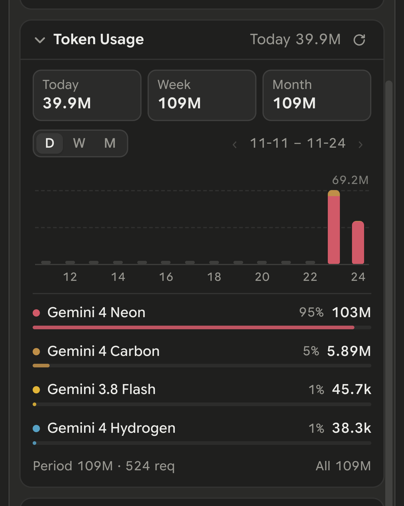

<div align="center">

# MAGA

### Make Antigravity Great Again

**顶级引擎，当然要配顶级驾驶舱。**  
*面向 macOS 上 Google Antigravity Desktop 2.0 的零侵入工作台升级套件——重塑视觉与双行四胶囊底栏、实时配额弹层与本机 Token 洞察、极简阶段同步与并行提效规则，再顺手补齐底栏子代理快捷分屏与一键静默续跑。*

[English](./README.md) · **简体中文**

[](#快速开始)
[](#为什么做-maga)
[](#快速开始)
[](#安全与零侵入设计)

[为什么做 MAGA？](#为什么做-maga) · [核心功能](#核心功能) · [快速开始](#快速开始) · [安全设计](#安全与零侵入设计) · [致谢](#致谢acknowledgements)

<br />


</div>

---

## 为什么做 MAGA？

说句大实话：**Gemini 4（以及 Claude Opus）强得没话说。**  
但浏览一圈 Reddit、Hacker News、V2EX 和 X 就会发现，大家对 **Google Antigravity Desktop 2.0** 的吐槽高度一致——问题并不在于某一个孤立小细节，而是这套桌面客户端的整体完成度还停留在半成品阶段：

| 社区高频吐槽的三大痛点 | MAGA 给出的完整解法 |
| :--- | :--- |
| **1. 2.0 桌面端视觉与高频交互偏半成品** — 视觉层级平淡，思考档位调节不够顺手，常用操作与状态遥测混在一起，窄分屏或长模型名下底栏容易挤压错乱。 | **克制视觉重塑 + 双行四胶囊底栏** — Claude 风格明/暗色排版与全局宿主语言跟随；常驻双行四胶囊将操作与遥测上下分层，窄宽与长路由名渐进收敛绝不换行，四大模型家族各配专属动效思考滑轨。 |
| **2. 上下文与配额一片黑箱** — 多轮规划与工具调用消耗极快，窗口水位、5h/周配额与真实 Token 去向不透明或深埋二级设置，长任务动不动突然撞墙。 | **全链路状态透明闭环** — 底栏常驻速率与上下文水位预警、一键 `Compact` 压缩；点开即看 Gemini & Claude / GPT 双池 5 小时 / 周配额；右侧原生融入 Overview 本机 Token 用量趋势，**事前预警、事中盯额度、事后看去向**。 |
| **3. 长流程缺少掌控感，卡顿或中断打断心流** — 复杂任务常常静默黑盒干跑半天看不到阶段进展，零散工具调用拖慢节奏，偶遇崩溃或中断还得重新手动接续。 | **可控执行节奏 + 重度工作流效率加分项** — 通过极简阶段同步与并行提效规则告别黑盒也不刷屏；同时顺手补齐底栏子代理快捷分屏与一键静默 `Resume` 兜底。 |

> [!NOTE]
> **清晰的产品边界**：除了正面解决上述三大桌面端痛点，MAGA 还为重度日常工作流顺手补齐了两项高频提效能力——**底栏子代理快捷入口与宽敞分屏**、**偶发中断一键静默 `Resume`**。全套增强通过单一本机守护进程运行，**全程不动 `/Applications/Antigravity.app` 一根毫毛**。

---

## 核心功能

### 1. 视觉排版重塑 & 双行四胶囊交互底栏

先把每天盯最久的主界面与输入区彻底磨顺手。

- **克制的视觉体系 & 全局宿主语言跟随** — 借鉴 Claude 风格的明/暗色对比与平衡字重，中英文混排久读不累；所有胶囊标签、提示语与时间线分割线自动与 Antigravity 当前界面语言保持一致。
- **操作与遥测上下分层** — 常驻双行底栏将高频动作收拢在上行（`+ Add context`、权限、语音、发送），将**模型与思考强度、上下文窗口、实时速率、子代理状态**四颗轻量胶囊整齐排布在下行。
- **专属动效模型与思考强度选择器** — 切换模型与思考档位不再翻深层菜单：Gemini 4 Neon 霓虹红、Carbon 碳纤金、Hydrogen 气泡冰蓝、Claude Opus 陶土橙各带专属动效滑轨，支持快捷切换 Orchestrator 与自定义隐藏模型。
- **宽窄屏与长名称渐进收敛** — 无论超宽屏、窄分屏，还是开启 Orchestrator 路由与长模型名，胶囊都会智能浓缩规划模型徽章并按实测宽度逐级精简，绝不折行、绝不挤压截断。

<p align="center">
  
  <br />
  <sub><i>切换不同模型家族自动呈现专属动效思考强度条，一键查看上下文水位压缩与 5h / 周套餐配额。</i></sub>
</p>

---

### 2. 全链路透明：实时配额弹层 & 原生本机 Token 洞察

从“事前预警、事中盯额度”到“事后看去向”，一口气打穿全网吐槽最多的额度黑箱。

- **底栏实时速率与上下文预警** — 下行速率胶囊持续显示生成速度与 TTFT 响应延迟；上下文水位环按占用分段变色预警，点开即可一键触发对话压缩。
- **Gemini & Claude / GPT 双池配额弹层** — 点击上下文胶囊即可在同一个轻弹层内切换查看 Gemini 与 Claude / GPT 双池的 5 小时及周配额余量，跑长任务前心里有数。

<table>
  <tr>
    <td width="56%" valign="middle">
      <ul>
        <li><b>原生融入右侧 Overview</b> — 在不打扰主对话的前提下，一屏汇总 Prompt 缓存命中率、轮次/调用统计、一键压缩与 5h / 周套餐配额。</li>
        <li><b>日 / 周 / 月趋势视图</b> — 交互式堆叠柱状图支持自由翻页，悬浮即看非缓存、缓存读写与输出明细。</li>
        <li><b>分模型家族消耗占比</b> — Gemini 与 Claude 各系列模型的用量分布一目了然。</li>
        <li><b>100% 本地单进程</b> — 复用现有单一守护进程增量读取本机对话库，零额外 sidecar、零数据外传。</li>
      </ul>
    </td>
    <td width="44%" align="center" valign="middle">
      
    </td>
  </tr>
</table>

---

### 3. 长流程掌控感与效率加分项

搞定核心痛点之余，把重度工作流的节奏感和顺滑度一并拉满。

#### 3.1 极简阶段同步与提效规则（告别黑箱也不刷屏）

针对长任务过程不透明、零散等待拖慢节奏的顽疾，MAGA 将极简并行检索/白名单命令规范与克制的分阶段汇报规则整合进 `~/.gemini/AGENTS.md`（仅 `7` 行，绝不限制回答深度），精准落在“静默黑盒”与“碎嘴刷屏”之间的黄金平衡点：

| 模式对比 | 复杂任务下的实际体验 |
| :--- | :--- |
| **原生静默执行** | 连续运行几十步毫无中间反馈，像在盯一个黑盒 |
| **逐条工具播报** | 每次调工具前都输出一两句，界面被过程水话刷屏 |
| **MAGA 阶段同步 + 提效规则** | **`1–4` 轮轻量任务直接给结果；`5` 轮以上复杂任务通过先 `grep` 后批读与免审白名单命令大幅减少无效等待，并在各阶段切换节点输出 `1` 句高信息量短句同步进展——告别黑箱也不刷屏，且绝不限制回答深度** |

#### 3.2 底栏子代理快捷入口 & 宽敞联动分屏

为了把子代理的日常查看与切换做得更顺手，MAGA 在底栏专门加入了独立快捷入口与自动化分屏体验：

- **从派发到完成一眼可见** — 主对话派发子代理后，底栏自动亮起蓝色呼吸胶囊，完成后立刻转为翠绿就绪态，不必反复切侧栏翻找进度。
- **一键自动清障分屏** — 点击底栏子代理胶囊即可直接打开宽敞对称的分屏视图，同时自动收起右侧 Overview 并移除冗余的内置子代理列表侧栏（状态与切换已由底栏胶囊菜单接管）；看完再点即利落收起退场，手动拖拽分屏宽度依旧自由。
- **双侧同款自适应底栏** — 子代理输入区同样享有自适应四胶囊，随分屏宽度智能收敛。

<p align="center">
  
  <br />
  <sub><i>派发子代理后底栏实时浮现胶囊（蓝呼吸 → 绿就绪）→ 点击底栏胶囊自动收起 Overview 与冗余侧栏展开宽敞分屏 → 再点收起退场。</i></sub>
</p>

#### 3.3 偶发中断一键静默 `Resume`

当长任务偶遇异常中断、崩溃重启或手动暂停时，给你一道安静无感的兜底保险：

- **上排左侧自动亮起 `Resume` 胶囊** — 检测到未完成回合即克制提示，不用手动补敲“请继续”。
- **零闪烁、无废话气泡** — 点一下即可静默唤醒模型从断点接续，输入框里不会闪现尴尬的预设文本，对话时间线上也只留下一条极轻的 **`▸ Resumed`** 细分割线。

<p align="center">
  
  <br />
  <sub><i>点击上排左侧的 <code>Resume</code> 胶囊静默续跑，输入框零闪烁，时间线仅保留克制的 <code>▸ Resumed</code> 分割线。</i></sub>
</p>

---

## 快速开始

**环境要求**：macOS · Node.js `>= 22` · Google Antigravity Desktop 2.0

```bash
git clone https://github.com/LiWithDream/MAGA.git
cd MAGA
npm run install-all
```

### 日常命令

| 命令 | 说明 |
| :--- | :--- |
| `npm run install-all` | 配置本机 LaunchAgent 守护进程、部署界面增强层并同步阶段进度与并行提效规则 |
| `npm run deploy` | 修改 `studio/` 下任意代码后秒级热更新（无需重启 Antigravity） |
| `npm run sync-rules` | 单独将最新的阶段进度同步与并行提效规则同步至 `~/.gemini/AGENTS.md` |
| `npm run doctor` | 全面体检守护进程、实时连接、注入状态、用量扫描器与规则/配置状态 |
| `npm run rollback` | 一键卸载 `studio` 增强层，干净恢复基础状态 |

---

## 安全与零侵入设计

> [!TIP]
> **零二进制魔改。** MAGA **从不修改** `/Applications/Antigravity.app`——苹果官方代码签名与 Antigravity 自动更新完全不受影响。

- **单一轻量守护进程** — 一个本机 LaunchAgent 统一承载界面增强、本地用量统计、子代理指标与断点续跑检测，不挂多余后台服务。
- **100% 本地隐私** — 所有 Token 统计与状态检测均在你的 Mac 本机完成，不上传、不代理、零遥测外传。
- **随时一键热更新与回滚** — 开发调试可秒级热更新，任何时候执行 `npm run rollback` 即可无痕退回基础状态。

<details>
<summary><b>想自己二次魔改？查看项目目录结构</b></summary>

```text
.
├── core/                  # 轻量本机 CDP 守护进程与基础运行时
├── user/                  # 基础主题与交互层模板
├── vendor/agy-capsule/    # 内化的零依赖模型选择器与遥测内核
├── studio/
│   ├── cli.mjs            # 统一命令行入口（install / deploy / sync-rules / doctor / rollback）
│   ├── build.mjs          # 模块打包与热部署管线
│   ├── daemon/            # 本机 SQLite 用量、子代理指标与中断状态服务
│   ├── modules/           # 前端模块化运行时（底栏、选择器、子代理、续跑、用量）
│   ├── styles/            # 分职责样式表（排版、胶囊、弹层、用量卡片）
│   └── rules/fast-io.md   # 7 行极简阶段同步与并行提效规则
├── test/                  # 自动化打包、DOM 与 CSS 回归测试
├── docs/images/           # 实机高清截图与交互演示动图
└── install.mjs            # LaunchAgent 与守护进程安装器
```

</details>

---

## 常见问题与排查（Troubleshooting）

### 遇到 `Error Loading Models` / `loadCodeAssist: EOF`

- **错误根因**：该报错来自 Antigravity 原生后端进程 `language_server` 访问 Google 接口（`daily-cloudcode-pa.googleapis.com`）时 TLS/代理连接意外断开，**并非 MAGA 前端注入逻辑导致**。
- **建议处理**：
  1. 在代理客户端（Clash / Mihomo / Surge / V2Ray 等）开启 **TUN（增强）模式**或**系统代理**，并确认 `daily-cloudcode-pa.googleapis.com`（及 `*.googleapis.com`）走稳定节点。
  2. **兼容增强**：如你习惯从终端附带代理环境变量（`HTTP_PROXY` / `HTTPS_PROXY` / `ALL_PROXY` / `NO_PROXY` / `SSL_CERT_FILE` / `NODE_EXTRA_CA_CERTS`）或 `--proxy-*` 启动参数拉起 Antigravity，MAGA 在 macOS 自动补充 `--remote-debugging-port=0` 重拉进程时会自动透传保留这些配置；也可运行 `npm run doctor` 查看 `proxyDiagnostics` 本地代理状态。
  3. 若希望完全由自己手动管理 `--remote-debugging-port=0` 启动参数而不由守护进程自动重拉，可在运行守护进程时设置环境变量 `ANTI_CLAUDE_NO_CDP_BOOTSTRAP=1`。

---

## 致谢（Acknowledgements）

MAGA 基于以下优秀的开源项目构建与演进，在此向各上游项目的作者与贡献者致以诚挚感谢，并清晰说明各项目的具体贡献与集成方式：

- [**hongqi7/Anti-Claude**](https://github.com/hongqi7/Anti-Claude) — 直接提供了零修改 `.app` 二进制的 Antigravity CDP 本机守护进程基础架构（`core/`）、Claude 风格明暗色视觉与排版体系、右侧 Overview 面板框架、上下文水位环与 5h/周配额弹层基础，以及分阶段执行同步规则的早期启发；MAGA 在此基础上抽离并构建了模块化 `studio/` 热更新层、双行四胶囊自适应底栏、底栏子代理快捷分屏、静默 `Resume` 及原生 Overview Token 用量集成。
- [**Lumidarin/agy-capsule**](https://github.com/Lumidarin/agy-capsule)（MIT 协议）— `vendor/agy-capsule/` 直接引入并整合了其零依赖增强模型与思考强度选择器、多模型家族动效主题、实时生成速率遥测以及本机 SQLite 对话用量解析方案（其中用量分析能力由 `studio/daemon/usage-service.mjs` 与 `studio/modules/overview-usage.mjs` 重构进 MAGA 单一守护进程与原生 Overview 面板）。
- **`antigravity-Codex-Claude-effort-slider`**（作者：月上寒 / `LLYSH-HANNARI`，MIT 协议）— 随 `agy-capsule` 引入；开创了各模型家族专属星尘/点阵/滑块动效设计，以及从宿主 React 树读取模型选项并一次提交模型与思考档位的实现思路。
- [**oil-oil/agy-fast-io**](https://github.com/oil-oil/agy-fast-io) — 直接贡献了先 `grep` 定位后批读、优先使用免审白名单裸命令及减少无效云端排队等待的核心效率法则；MAGA 将其核心检索与批处理原则精炼为 `studio/rules/fast-io.md`（不限制回答深度），并与分阶段进度简报融合为 `7` 行极简工作台同步规则。

---

<div align="center">
  <sub>如果 MAGA 让你的 Gemini 4 + Antigravity 日常开发顺手了不少，欢迎点一颗 ⭐ 支持一下！</sub>
</div>
