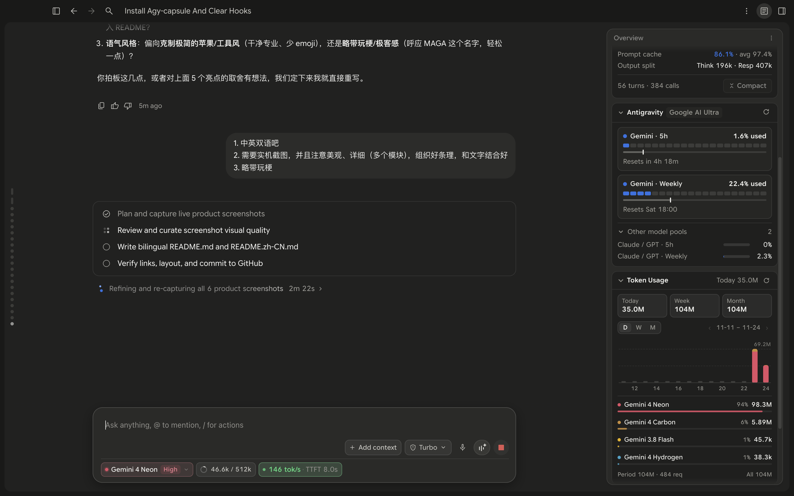
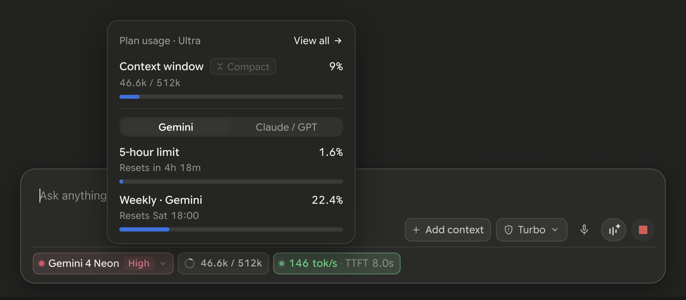

<div align="center">

# MAGA — Make Antigravity Great Again

**献给 macOS 上 Google Antigravity Desktop 2.0 的非官方工作台增强套件。**  
*不动原生安装包，不破苹果签名，体验直接拉满。*

[English](./README.md) · **简体中文**


<br />



</div>

---

## 为什么做 MAGA？

Google Antigravity 2.0 的底座很强，但重度用下来总有一堆硌手的小毛病：分屏时底栏挤成一团、英文思考过程刷屏占满视野、子代理状态切来切去容易迷路，还有每次 App 意外重启或任务中断，都得像 2023 年一样手打一句“请继续”……

**MAGA** 用一套单一轻量的本机运行时，把这些高频痛点一次性打磨到位——**完全不碰 `/Applications/Antigravity.app`**，保留原生 macOS 签名，支持秒级热更新，不想要也能一键无痕回滚。

---

## 核心体验一览

### 1. 秩序重塑的输入底栏 & 自适应四胶囊

操作归操作，状态归状态。常驻双行底栏将交互按钮与状态遥测自然分层：上行收拢 `+ Add context` 与权限/语音/发送操作，下行统一排列**模型与思考强度、上下文占用、实时速率、子代理状态**四个高辨识胶囊。

无论全屏写作还是拉窄分屏，底栏都会随宽度平滑收敛，告别挤压、换行与文字截断。

<table>
  <tr>
    <td width="50%" valign="top">
      
      <p align="center"><sub><b>模型与思考强度胶囊</b> — 家族专属配色、动效思考强度滑块、Orchestrator 开关，支持自定义隐藏模型。</sub></p>
    </td>
    <td width="50%" valign="top">
      
      <p align="center"><sub><b>上下文与配额弹层</b> — 占用预警提示、一键压缩上下文，以及 5 小时 / 周配额一目了然。</sub></p>
    </td>
  </tr>
</table>

---

### 2. 丝滑联动的 50/50 子代理分屏

多代理协作，不该变成一场拖拽窗口边框的体力活。

- **一键直达与收起**：点击主底栏的子代理胶囊直接切入对应分屏，再次点击即可收起，交互干净利落。
- **默认 50/50 对称分屏**：展开子代理侧栏时自动平分视野，手动拖拽依然完全自由，同时兜住双侧最小阅读宽度，告别压扁变窄。
- **Overview 自动互斥**：展开子代理侧栏自动收起右侧 Overview（反之亦然），桌面永远保持清爽，不玩三栏手风琴。
- **同款底栏 & 无噪音退场**：子代理输入区同步享有自适应四胶囊；任务完成后在你查看或开启下一轮对话时自然退场，只保留当下值得关注的状态。


---

### 3. 中断任务一键静默续跑

重构到一半 App 崩了、电脑重启了，或者中途手动点停了？

MAGA 会自动识别未完成的中断对话，并在底栏亮起一颗克制的 **`Resume`** 胶囊。点一下即可静默唤醒模型从断点接续工作——输入框不会闪现尴尬的预设文字，对话流里也不会多出一个突兀的“请从上次中断处继续”气泡，只在时间线上留下一条极轻的 **`▸ Resumed`** 细分割线。

<p align="center">
  
</p>

---

### 4. 原生融入的本地 Token 用量洞察

不用额外部署统计服务，也不用把对话数据传到任何云端，直接在工作台里看清每一笔 Token 去向。

<table>
  <tr>
    <td width="56%" valign="middle">
      <ul>
        <li><b>原生级 Overview 融合</b> — 直接内化在右侧 Overview 面板中，与套餐配额自然排布。</li>
        <li><b>日 / 周 / 月趋势视图</b> — 堆叠柱状图支持自由翻页，悬浮即看缓存读写与输出明细。</li>
        <li><b>分模型家族占比</b> — Gemini、Claude 各模型消耗一目了然。</li>
        <li><b>100% 本机增量统计</b> — 复用现有单一守护进程，无额外常驻 sidecar，轻量零负担。</li>
      </ul>
    </td>
    <td width="44%" align="center" valign="middle">
      
    </td>
  </tr>
</table>

---

### 5. 专注阅读与零侵入工程底色

- **更安静的对话流**：收起冗长的英文思考正文，只留干净的 `Thought for Xs` 状态行；繁杂的工具调用记录默认折叠，需要时再点开细看。
- **更顺眼的排版与语言统一**：明/暗色下平衡的字重对比度与中英文观感，全局组件文案自动跟随 Antigravity 当前界面语言。
- **更利落的读写节奏**：内置精简版 `fast-io` 全局效率规则，减少无效检索与来回等待，同时绝不阉割回答深度与完整度。
- **零侵入、随时可撤**：全程不修改 `/Applications/Antigravity.app`，支持不重启热更新与一键干净回滚。

---

## 快速开始

**环境要求**：macOS · Node.js `>= 22` · Google Antigravity Desktop 2.0

```bash
# 1. 完整安装（配置本机 LaunchAgent 守护进程 + 部署界面增强 + 同步 fast-io 规则）
npm run install-all

# 2. 修改 studio/ 下任意代码后秒级热更新（无需重启 Antigravity）
npm run deploy

# 3. 全面体检（守护进程、实时连接、注入状态、本机用量扫描与关键配置）
npm run doctor

# 4. 一键回滚 studio 增强层，恢复基础状态
npm run rollback
```

<details>
<summary><b>想自己魔改？查看项目目录结构</b></summary>

```text
.
├── core/                  # 轻量本机 CDP 守护进程与基础运行时
├── user/                  # 基础主题与交互层模板
├── vendor/agy-capsule/    # 内化的零依赖模型选择器与遥测内核
├── studio/
│   ├── cli.mjs            # 统一命令行入口（install / deploy / doctor / rollback）
│   ├── build.mjs          # 模块打包与热部署管线
│   ├── daemon/            # 本机 SQLite 用量、子代理指标与中断状态服务
│   ├── modules/           # 前端模块化运行时（底栏、选择器、子代理、续跑、用量）
│   ├── styles/            # 分职责样式表（排版、胶囊、弹层、用量卡片）
│   └── rules/             # 精简版 fast-io 效率规则
├── docs/images/           # 实机成品截图
└── install.mjs            # LaunchAgent 与守护进程安装器
```

</details>

---

## 致谢（Acknowledgements）

MAGA 是一个独立演进的工作台增强项目，其设计灵感与部分底层思路受益于以下优秀的开源项目，在此向原作者致以诚挚感谢：

- [**hongqi7/Anti-Claude**](https://github.com/hongqi7/Anti-Claude) — 提供了稳定零依赖的 Antigravity CDP 守护进程架构、Claude 风格界面体系与右侧 Overview 面板基础。
- [**Lumidarin/agy-capsule**](https://github.com/Lumidarin/agy-capsule) — 启发了极具质感的模型与思考强度动效选择器、速率状态指示设计以及本机 SQLite 对话用量统计思路。
- [**oil-oil/agy-fast-io**](https://github.com/oil-oil/agy-fast-io) — 启发了 `studio/rules/fast-io.md` 中的快速检索与命令批处理效率规则。
